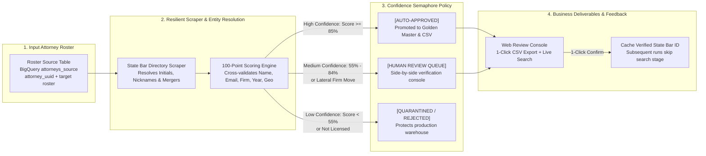
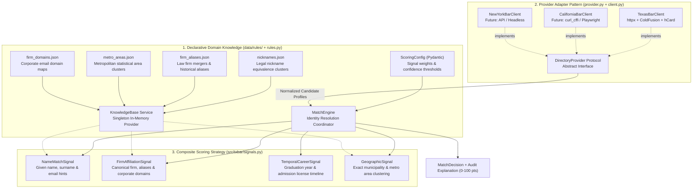
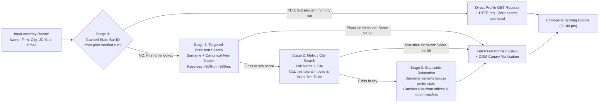
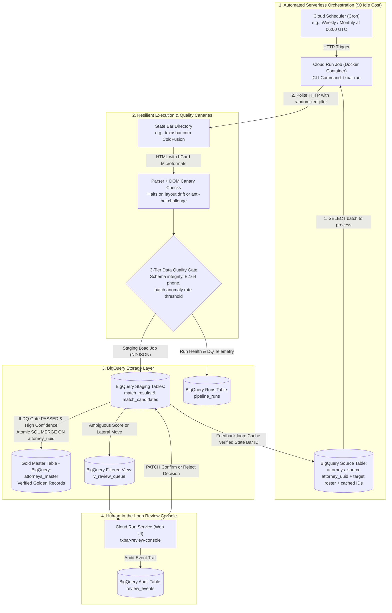

# Serverless ETL & Entity Resolution Pipeline

[](https://github.com/zebok/attorney-scrapper/actions/workflows/ci.yml)
[](https://www.python.org/downloads/)
[](https://opensource.org/licenses/MIT)
[](https://github.com/astral-sh/ruff)
[](https://cloud.google.com/)

A production-grade data enrichment framework featuring resilient web ingestion, multi-signal identity reconciliation, and human-in-the-loop review on Google Cloud Platform and BigQuery.

*Reference Implementation: State Bar Legal Directory & Professional Roster Verification.*

---

## Architecture & ETL Overview

Cross-referencing internal rosters against public registries presents fundamental data engineering challenges: stateful web sessions, strict rate limits, unnormalized naming formats, and homonym collisions. 

This repository provides an enterprise-ready, serverless ETL framework designed to reconcile messy input data against state-maintained directories with sub-millisecond scoring and verifiable audit trails.

- **Extract (Resilient Web Ingestion)**: Adaptive rate limiting with randomized crawl-delay jitter, ColdFusion session bootstrapping, automatic exponential backoff retries, and layout drift canaries (`DomDriftError`).
- **Transform & Reconcile (Multi-Signal Scoring Engine)**: Decoupled 0-100 scoring engine cross-validating name similarity, corporate firm affiliations, historical merger aliases, career timeline plausibility, and metropolitan area statistical clustering.
- **Load (Staging-to-Gold Lakehouse)**: Staging ingestion via BigQuery Load Jobs (NDJSON) followed by atomic SQL `MERGE` into golden master tables upon passing automated 3-tier Data Quality gates.
- **Operational Review (Human-in-the-Loop Console)**: Single-page executive web console built with FastAPI, enabling side-by-side candidate comparison, one-click confirmation, and verified ID feedback caching to accelerate subsequent runs.

---

## Key Features

- **Resilient & Polite Ingestion**: Adaptive crawl delays with randomized jitter, session bootstrapping, backoff retries, and high-performance HTML parsing via `selectolax` (Lexbor engine).
- **Composite Multi-Signal Scoring (0–100 pts)**:
  - **Name Match (35 pts)**: Nicknames, middle initials, suffixes, preferred names, and corporate email handle corroboration.
  - **Firm Affiliation (25 pts)**: Canonical firm normalization, historical merger aliases, and corporate email domain mapping.
  - **Temporal Consistency (25 pts)**: Graduation year and state directory admission date alignment with multi-year tolerance.
  - **Geographic Alignment (15 pts)**: Exact municipality matching and Metropolitan Statistical Area (MSA) clustering.
- **Three-Tier Confidence Semaphore Policy**:
  - `auto_approved` (>= 85 pts): Automatically promoted to golden master records with extracted E.164 phone numbers.
  - `needs_review` (55 - 84 pts or detected lateral firm move): Routed to the review console for side-by-side verification.
  - `quarantined` (< 55 pts or unlicensed): Excluded from production deliverables to protect warehouse integrity.
- **Human-in-the-Loop Web Console**: Lightweight, responsive dashboard with side-by-side evidence inspection, candidate selection, search filtering, and 1-click CSV download.
- **Dual Storage Backend**: Supports local CSV storage (default for offline/local development) and Google BigQuery for production lakehouse runs.
- **Automated Data Quality Gate**: 3-tier validation (field-level regex, cross-attribute consistency, and batch-level anomaly thresholds) that halts master promotion if error rates spike.
- **Serverless Cloud Deployment**: Multi-stage Dockerfile and full Terraform Infrastructure-as-Code for zero-idle-cost execution on Cloud Run Jobs, BigQuery, Cloud Scheduler, and Secret Manager.

---

## Quick Start (60 Seconds)

### Prerequisites

- Python 3.12+
- [uv](https://docs.astral.sh/uv/) (recommended) or standard `pip`

### 1. Installation

```bash
# Clone the repository
git clone https://github.com/zebok/attorney-scrapper.git
cd attorney-scrapper

# Install dependencies with uv
uv sync
```

*Or using standard `pip`:*

```bash
python3 -m venv .venv
source .venv/bin/activate
pip install -e .
```

### 2. Configuration

Copy the example environment configuration:

```bash
cp .env.example .env
```

*By default, `STORAGE_BACKEND=csv` is enabled, allowing the pipeline and review console to run locally without cloud credentials.*

### 3. Verify Directory Health & Connectivity

```bash
txbar health
```

### 4. Run Batch Enrichment

```bash
# Test run with first 5 records
txbar run --limit 5

# Or run the full roster
txbar run
```

### 5. Launch the Review Console

```bash
txbar ui --port 8080
```

Open `http://localhost:8080` in your browser to inspect matches, review ambiguous candidates, and export reports.

---

## System Architecture

### 1. Executive Pipeline & Confidence Semaphore
Visualizes the end-to-end flow from input roster to enriched delivery, highlighting the 3-tier confidence policy, the executive review console, and the self-accelerating State Bar ID feedback loop.



---

### 2. Internal Engine & Extensible Design Patterns
Illustrates how the codebase decouples state directory HTTP clients, declarative domain knowledge, and multi-signal scoring algorithms to scale from 1 state to 50+ state bar associations.



---

### 3. 4-Stage Waterfall Search Algorithm
Details how the scraper queries state bar directories efficiently without wasting HTTP requests or getting tripped up by initials, suffixes, or firm relocations.



---

### 4. Cloud-Native Architecture (GCP & BigQuery)
Shows the automated serverless deployment on Google Cloud Platform, the 3-tier Data Quality gate, and the staging-to-gold lakehouse pattern in BigQuery.



---

## CLI Reference

The package installs the `txbar` command-line interface:

| Command | Arguments / Options | Description |
|:---|:---|:---|
| `txbar health` | | Validates Texas Bar directory connectivity, session bootstrapping, and DOM landmark canaries. |
| `txbar run` | `--limit N` | Executes the batch enrichment pipeline over the source roster. |
| `txbar ui` | `--host HOST`, `--port PORT` | Launches the interactive review console and REST API. |
| `txbar export-csv` | `--out PATH` | Exports enriched golden records from active storage to clean delivery CSV. |
| `txbar seed` | `--csv PATH` | Normalizes and seeds an input CSV into the active `attorneys_source` table. |

---

## Configuration Reference

Configuration is managed via Pydantic Settings and loaded from environment variables or `.env`:

| Variable | Default | Description |
|:---|:---|:---|
| `STORAGE_BACKEND` | `csv` | Persistence engine: `csv` (local directory) or `bigquery` (GCP). |
| `LOCAL_WAREHOUSE_DIR` | `data/warehouse` | Directory storing local CSV tables mirroring BigQuery 1:1. |
| `DEFAULT_INPUT_CSV` | `data/input/tx_lawyers.csv` | Default source roster CSV path. |
| `RULES_DIR` | `data/rules` | Location of declarative JSON domain rules. |
| `SCHEMAS_DIR` | `schemas` | JSON table schemas shared between Polars frames and Terraform. |
| `GCP_PROJECT_ID` | `None` | Google Cloud project ID (required when `STORAGE_BACKEND=bigquery`). |
| `BQ_DATASET` | `txbar` | BigQuery dataset name. |
| `GCP_REGION` | `us-central1` | Google Cloud region for BigQuery dataset and Cloud Run. |
| `REVIEWER_TOKEN` | `""` | Secret required in `X-Reviewer-Token` header for review decisions (empty disables auth). |
| `WEIGHT_NAME` | `35.0` | Max score points for name similarity. |
| `WEIGHT_FIRM` | `25.0` | Max score points for law firm affiliation and merger aliases. |
| `WEIGHT_TEMPORAL` | `25.0` | Max score points for graduation year vs license date alignment. |
| `WEIGHT_GEO` | `15.0` | Max score points for municipality and metropolitan cluster. |
| `MATCH_AUTO_APPROVE`| `85.0` | Minimum score for automatic golden master promotion. |
| `MATCH_REVIEW_FLOOR`| `55.0` | Minimum score to enter human review queue (below is quarantined). |
| `MATCH_AMBIGUITY_DELTA` | `8.0` | Score delta between top candidate and runner-up that triggers review. |

---

## Extensibility: Adding Other State Bars

The system decouples state directory implementations via the `DirectoryProvider` protocol (`src/txbar/provider.py`). Adding a new state (e.g. California or New York) requires only implementing this interface:

```python
from txbar.provider import DirectoryHit, DirectoryProvider, Profile, ProviderHealth


class CaliforniaBarClient(DirectoryProvider):
    provider_id = "cabar"
    provider_name = "State Bar of California"

    def search_by_affiliation(self, last_name: str, firm_core: str) -> list[DirectoryHit]: ...
    def search_by_location(self, name: str, city: str) -> list[DirectoryHit]: ...
    def search_statewide(self, last_name: str) -> list[DirectoryHit]: ...
    def get_profile(self, contact_id: str) -> Profile: ...
    def health_check(self) -> ProviderHealth: ...
    def profile_url(self, contact_id: str) -> str: ...
```

The composite scoring engine, waterfall resolution, data quality canaries, and BigQuery schemas remain completely unchanged.

---

## Testing & Quality Assurance

The test suite covers parsing, signals, homonym disambiguation, storage backends, and API endpoints without making external network calls:

```bash
# Run unit tests with pytest
uv run pytest -v

# Run linter
uv run ruff check .

# Check code formatting
uv run ruff format --check .
```

---

## Project Structure

```text
├── .github/
│   └── workflows/ci.yml       # Automated GitHub Actions test & lint suite
├── data/
│   ├── input/                 # Source attorney rosters
│   ├── output/                # Enriched deliverables and run reports
│   └── rules/                 # Declarative firm aliases, metro areas, nicknames
├── docs/
│   └── DIAGRAMS_EN.md         # Full architecture and sequence diagrams
├── infra/
│   └── terraform/             # GCP Cloud Run, BigQuery, Cloud Scheduler IaC
├── schemas/                   # Single-source-of-truth JSON table schemas
├── src/txbar/
│   ├── client.py              # Polite HTTP client for Texas Bar directory
│   ├── config.py              # Runtime configuration via Pydantic Settings
│   ├── matching.py            # Waterfall search coordinator and decision semaphore
│   ├── normalize.py           # Robust name, suffix, firm, and phone normalizers
│   ├── parser.py              # HTML extraction via Selectolax & DOM canary checks
│   ├── pipeline.py            # Batch orchestration and deliverable formatting
│   ├── provider.py            # DirectoryProvider protocol & unified domain models
│   ├── quality.py             # 3-tier Data Quality gate and anomaly detectors
│   ├── rules.py               # Declarative KnowledgeBase rule provider
│   ├── schemas.py             # Polars schema enforcement matching BigQuery 1:1
│   ├── signals.py             # Decoupled Name, Firm, Temporal, and Geo signals
│   ├── storage.py             # Interchangeable CSV & BigQuery storage backends
│   └── web/                   # Interactive review dashboard & FastAPI REST API
├── tests/                     # Unit test suite & sanitized HTML fixtures
├── Dockerfile                 # Multi-stage production container
├── pyproject.toml             # Project metadata, dependencies, and tools configuration
├── CONTRIBUTING.md            # Guidelines for open-source contributors
└── LICENSE                    # MIT License
```

---

## Contributing

Contributions, issues, and feature requests are welcome! Please review [CONTRIBUTING.md](CONTRIBUTING.md) before opening a pull request.

---

## License

This project is licensed under the [MIT License](LICENSE).
