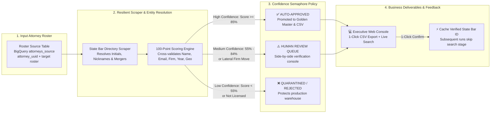
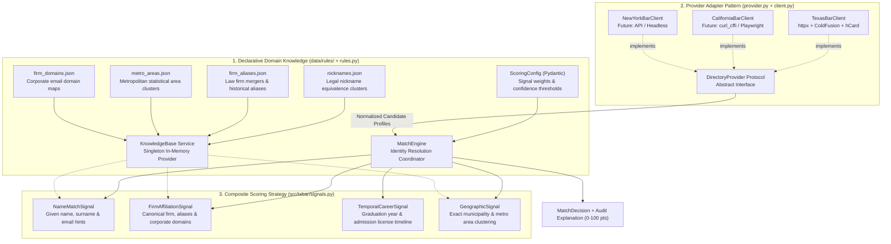
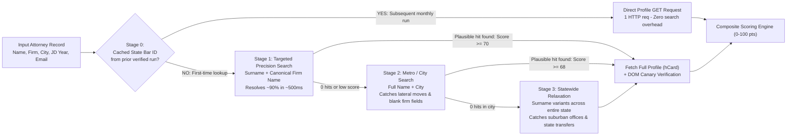
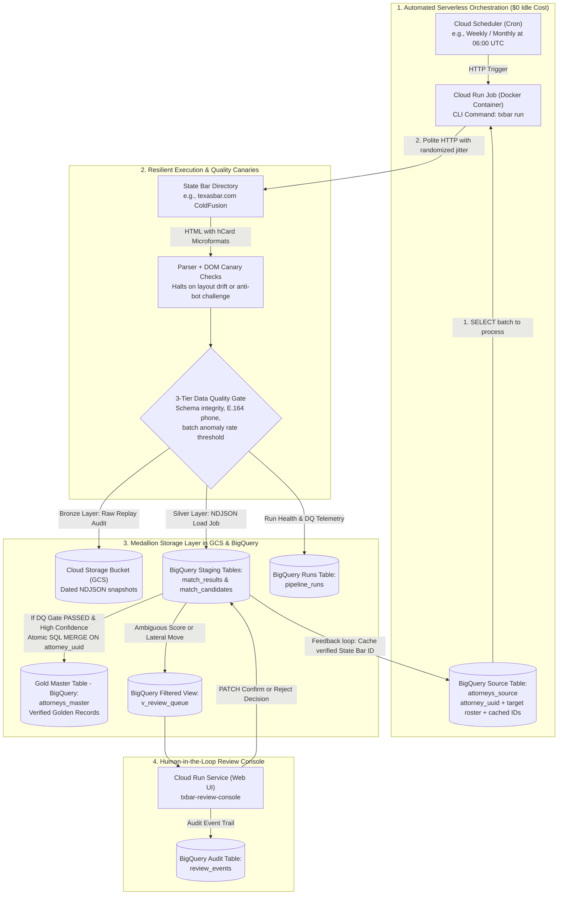

# Texas Bar Attorney Enrichment & Entity Resolution Pipeline

An end-to-end data pipeline that enriches attorney rosters against the State Bar of Texas directory with high-confidence entity resolution, polite scraping, and human-in-the-loop review.

---

## Key Features

- **Resilient & Polite Scraper**: Adaptive rate limiting (crawl-delay with jitter), retry mechanisms with exponential backoff, and robust HTML parsing via `selectolax`.
- **Composite Scoring Engine (0–100)**: Multi-signal identity resolution evaluating:
  - Name similarity (handling nicknames, initials, compound surnames)
  - Law firm matching & alias resolution
  - Email domain & handle corroboration
  - Bar admission year vs. JD year
  - Geographic/metro area validation
- **Three-Tier Confidence Policy**:
  - `auto_approved` ($\ge 85$): Directly promoted to golden master records.
  - `needs_review` ($55 - 84$ or detected lateral firm move): Sent to the review queue.
  - `quarantined` ($< 55$ or not licensed): Excluded from production deliverables.
- **Human-in-the-Loop Web Console**: Lightweight FastAPI web dashboard to inspect ambiguous matches, compare side-by-side evidence, and confirm/reject candidates with 1 click.
- **Dual Storage Backend**: Supports Google BigQuery + Cloud Storage for production cloud runs, as well as local CSV storage for offline development.
- **Cloud-Ready**: Packaged with multi-stage Dockerfile and full Terraform IaC for deployment on Google Cloud Run + BigQuery + Cloud Scheduler.

---

## System Architecture & Diagrams

### 1. Executive Pipeline & Confidence Semaphore
Visualizes the end-to-end flow from input roster to enriched delivery, highlighting the 3-tier confidence policy, the executive review console, and the self-accelerating State Bar ID feedback loop.



---

### 2. Internal Engine & Extensible Design Patterns
Illustrates how the codebase decouples state directory HTTP clients, declarative domain knowledge, and multi-signal scoring algorithms to scale from 1 state to 50+ state bar associations.



---

### 3. 4-Stage Waterfall Search Algorithm
Details how the scraper queries state bar directories efficiently without wasting HTTP requests or getting tripped up by initials, suffixes, or firm relocations.



---

### 4. Cloud-Native Architecture (GCP & BigQuery)
Shows the automated serverless deployment on Google Cloud Platform, the 3-tier Data Quality gate, and the Medallion lakehouse pattern in BigQuery.



---

## Getting Started

### Prerequisites

- Python 3.12+
- [uv](https://docs.astral.sh/uv/) (recommended) or standard `pip`

### 1. Installation

Clone the repository and install dependencies:

```bash
git clone https://github.com/zebok/attorney-scrapper.git
cd attorney-scrapper
uv sync
```

Or using `pip`:

```bash
python3 -m venv .venv
source .venv/bin/activate
pip install -e .
```

### 2. Configuration

Copy the example environment file and adjust your settings as needed:

```bash
cp .env.example .env
```

To run purely locally without Google Cloud:
```env
STORAGE_BACKEND=csv
```

---

## Usage (CLI)

The package installs the `txbar` CLI command:

### Check Health & Connectivity
Verify Texas Bar directory access and DOM structure:
```bash
txbar health
```

### Run Enrichment Pipeline
Run batch enrichment on the input attorney roster:
```bash
# Run on full roster
txbar run

# Or test with a limit
txbar run --limit 5
```

### Launch Review Console
Start the interactive review dashboard:
```bash
txbar ui --port 8080
```
Open `http://localhost:8080` in your browser to inspect matches, review ambiguous candidates, and export reports.

### Export Results
Export enriched records directly to CSV:
```bash
txbar export-csv --out data/output/enriched_tx_lawyers.csv
```

---

## Running Tests

Execute the unit test suite:

```bash
uv run pytest
```

---

## Project Structure

```text
├── data/
│   ├── input/             # Source attorney rosters
│   ├── output/            # Enriched deliverables and run reports
│   └── rules/             # Declarative firm aliases, metro areas, nicknames
├── docs/
│   └── DIAGRAMS_EN.md     # Architecture and sequence diagrams
├── infra/
│   └── terraform/         # GCP Cloud Run, BigQuery, GCS infrastructure
├── schemas/               # BigQuery JSON table schemas
├── src/txbar/
│   ├── client.py          # Polite HTTP client for Texas Bar directory
│   ├── parser.py          # HTML extraction and data normalization
│   ├── matching.py        # Entity resolution scoring engine
│   ├── pipeline.py        # Orchestration and data quality checks
│   ├── storage.py         # BigQuery and CSV persistence layer
│   └── web/               # FastAPI review dashboard and UI
├── tests/                 # Unit tests and HTML fixtures
├── Dockerfile             # Multi-stage production container
└── pyproject.toml         # Project metadata and dependencies
```

---

## License

MIT
