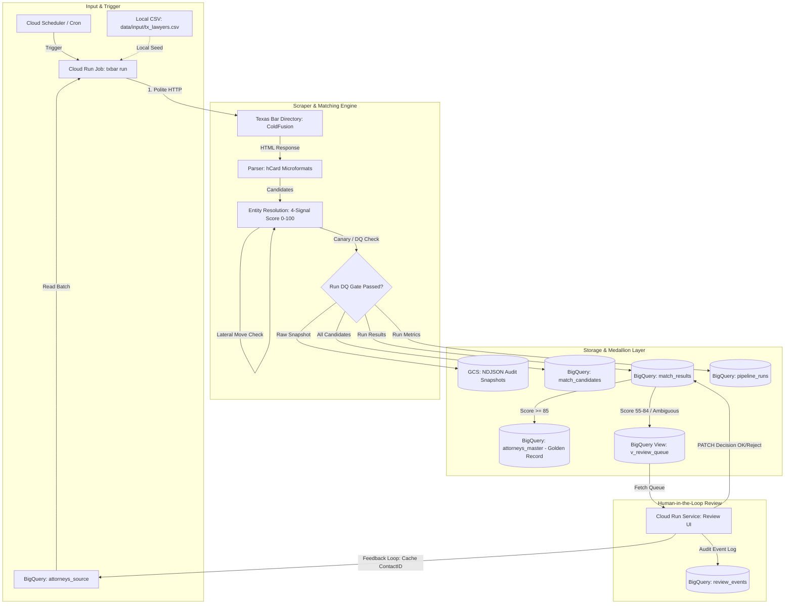
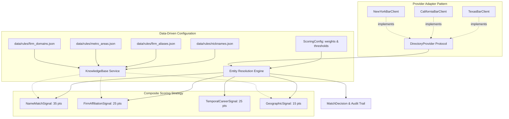

# Texas Bar Attorney Enrichment & Entity Resolution Pipeline

[](https://www.python.org/)
[](https://opensource.org/licenses/MIT)
[](https://github.com/astral-sh/ruff)
[](https://cloud.google.com/)

A production-grade, resilient data extraction and identity resolution pipeline built for **Recruiter BackOffice**. It enriches attorney rosters against the **State Bar of Texas** official directory, resolves homonyms via multi-signal confidence scoring, detects lateral firm moves, enforces strict data-quality gates, and provides a clean executive review & export web console.

### Batch Results Summary (100 Texas Attorneys)

| Metric | Count | Details |
|---|---|---|
| **Total Roster Processed** | **100** | Loaded from input sheet (`data/input/tx_lawyers.csv`) |
| **Auto-Verified Matches ($\ge 85\%$)** | **95 (95.0%)** | Exact or alias-verified identity matches automatically promoted to `attorneys_master` |
| **Direct Phones Extracted** | **81** | Normalized and validated to NANP / E.164 (`+1XXXXXXXXXX`) |
| **Held for Human Review ($55\text{--}84\%$)** | **3 (3.0%)** | **1 Lateral Firm Move** (*Joshua Michaels*: Buchalter $\rightarrow$ Griffith Davison) + **2 Incomplete Bar Profiles** (no firm/address listed on Bar site) |
| **Not Licensed / Not Found ($< 55\%$)** | **2 (2.0%)** | *Breegan Mayrant* (0 hits in TX) and *Christie Westmoreland* (only 1998 municipal prosecutor in TX; rejected as homonym) |

---

## 1. System Architecture

The pipeline follows a cloud-native **Medallion Architecture** deployed on Google Cloud Platform, while providing a zero-dependency **Local Warehouse Mode** (CSV mirroring BigQuery 1:1) so reviewers can test the entire workflow locally without GCP credentials.



### 1.1 Extensible Multi-State Architecture & Design Patterns

To scale seamlessly from Texas to 50+ state bar directories without rewriting entity resolution or BigQuery logic, the internal engine decouples **Directory Providers**, **Declarative Domain Rules**, and **Composite Scoring Signals**:



1. **Directory Provider Abstraction (Adapter Pattern)**:
   * `DirectoryProvider` (`src/txbar/provider.py`) decouples the matching engine from Texas Bar HTML forms.
   * `TexasBarClient` implements `DirectoryProvider`. Adding California (`ca_bar`) or New York (`ny_bar`) requires zero changes to the entity resolution engine, data quality gate, or BigQuery schemas.
2. **Data-Driven Declarative Rules (`data/rules/`)**:
   * Domain dictionaries are externalized into declarative JSON files:
     * `data/rules/nicknames.json`: Legal nickname equivalence clusters.
     * `data/rules/firm_aliases.json`: Law firm mergers, rebrandings, and historical aliases.
     * `data/rules/firm_domains.json`: Corporate email domain mappings.
     * `data/rules/metro_areas.json`: Metropolitan statistical area clusters.
   * Managed via `KnowledgeBase` (`src/txbar/rules.py`). Business analysts can add firm mergers or aliases without touching Python code or triggering redeployments.
3. **Composite Scoring Strategy (`txbar.signals`)**:
   * Evaluates identity through 4 isolated, testable signals (`NameMatchSignal`, `FirmAffiliationSignal`, `TemporalCareerSignal`, `GeographicSignal`).
   * Governed by `ScoringConfig` (Pydantic), eliminating hardcoded magic numbers and enabling runtime tuning.
4. **Dependency Injection**:
   * `Pipeline` accepts an injected `DirectoryProvider` and `MatchEngine`, enabling fast, 100% mocked testing with zero external HTTP dependencies (`tests/test_pipeline_di.py`).

### 1.2 Exploratory Findings & Real-World US Legal Nuances

Before writing the scraper, we audited the 100-attorney input sheet against live `texasbar.com` profiles and identified five domain nuances specific to US legal directories:

1. **Middle-Name Preference & Initials (`W. Buechele` $\rightarrow$ `'Bryant Buechele'`)**:
   * In US legal practice, attorneys frequently abbreviate their legal first name (`W.`) and practice under their middle name (`Bryant`), reflected in their corporate email (`bbuechele@winstead.com`). Searching `"W. Buechele"` on `texasbar.com` returns 0 hits. By querying `Name = Buechele` + `CompanyName = Winstead` and extracting the hCard quoted nickname (`'Bryant Buechele'`), the pipeline resolves him at 100%.
2. **Generational Suffixes & Informal Nicknames (`Wayne Zeringue III` $\rightarrow$ `'Jack'`)**:
   * Roman numerals (`III`, `IV`) break standard surname lookups if not stripped prior to querying. Furthermore, attorneys often use traditional US nicknames (`'Jack'` for *Wayne Zeringue III*, matching `jzeringue@sidley.com`; `'Taylor'` for *Theodore N. McDowell III*).
3. **Single vs. Compound Surnames (`Luisa Gutierrez Quintero` vs. `Mary Anna Rutledge`)**:
   * A 3-token name in the US can either be a compound given name (*Mary Anna* + *Rutledge*) or a Hispanic compound family name (*Luisa* + *Gutierrez Quintero*). Our normalizer inspects the corporate email prefix (`lgutierrezquintero@` vs. `mrutledge@`) to determine the exact surname boundary before querying the directory.
4. **Texas Metro Sprawl (`Dallas` vs. `Coppell` / `Plano`)**:
   * Recruiting rosters list major market hubs (`Dallas`, `Houston`, `Austin`), whereas the State Bar records the physical suburban municipality of the office (e.g., *Aileen Glaeser* listed as Dallas in the sheet, but registered in *Coppell, TX*). Grouping suburbs into Metropolitan Statistical Areas (`data/rules/metro_areas.json`) prevents false negatives.
5. **Out-of-State Lateral Admissions (`JD Year` $\neq$ `TX License Date`)**:
   * Many BigLaw attorneys graduate law school in NY/CA (`JD Year = 2018`) and waive into the Texas Bar years later (`TX License Date = 2025`, e.g., *Patrick Dolan*). Comparing `JD Year` against both the law school graduation date and admission date prevents penalizing lateral transfers.

---

## 2. Answers to Technical Challenge Questions

### Question 2: How the Scraper Works Internally
- **Session Lifecycle & Protocol**: The Texas Bar directory runs on Adobe ColdFusion hosted on Microsoft IIS 8.5. The scraper first bootstraps a session by requesting `/CustomSource/MemberDirectory/Search_Form_Client_Main.cfm` to obtain valid session cookies (`CFID`, `CFTOKEN`, and `JSESSIONID`).
- **Targeted Form Discovery**: While the public form has separate inputs, the directory colleague form (`SearchForm_Colleague`) uses a single `Name` parameter alongside `CompanyName` and `PPlCityName`. Submitting `Name = <FamilyName>` and `CompanyName = <FirmCore>` acts as an ultra-fast filter, reducing candidate sets from 50+ to 1–2 records in ~500ms.
- **Robust Semantic Parsing**: Rather than fragile regex or positional DOM selectors, `src/txbar/parser.py` parses standard semantic **hCard microformats** rendered by the directory (`given-name`, `additional-name`, `family-name`, `honorific-suffix`). Crucially, single-quoted strings in names are parsed into a dedicated `preferred_name` field (e.g., `'Bryant Buechele'` for William Bryant Buechele; `'Jack'` for Wayne Zeringue III).
- **Waterfall Lookup Strategy**:
  1. *Direct Cache Lookup*: If `txbar_contact_id` or `bar_card_number` is already cached from a prior run or human approval, the scraper fetches the profile directly, bypassing search entirely.
  2. *Targeted Search*: `Name = last_name`, `CompanyName = firm_search_term` (highest precision).
  3. *City Geo Search*: `Name = full_name`, `PPlCityName = city`.
  4. *Statewide Relaxation*: `Name = last_name_variants` (handles attorneys who moved across Texas cities or work from suburban offices).

---

### Question 3: Running Consistently & Detecting Failures Early
- **Polite Concurrency with Jitter**: The site's `robots.txt` specifies `Crawl-delay: 1`. Our client operates with randomized polite delays between 1.2s and 2.8s, simulating natural human navigation and preventing burst triggers.
- **Circuit Breaker via DOM Drift Canaries**: Web scrapers rarely fail with HTTP 500; they fail silently when an anti-bot page or layout change returns HTTP 200 with no content. `TexasBarClient` checks for mandatory DOM canary markers on every response. If expected landmarks (`hcard-Lawyer-L-Name`, `Bar Card Number`, `result-set`) vanish, it immediately raises `DomDriftError` and halts the run before invalid null records pollute the warehouse.
- **Exponential Backoff**: Transient 429 or 5xx responses trigger exponential backoff with randomized jitter (`(2^attempt) + jitter`).
- **Checkpointing & Interruption Tolerance**: Each evaluated attorney is appended line-by-line to `data/output/checkpoints/<run_id>.ndjson`. If a network partition interrupts a 500-attorney batch, the pipeline resumes without re-scraping completed rows.
- **The "Second-Run" Performance Multiplier**: Once an attorney is verified, the pipeline caches their official Texas Bar `ContactID` and `BarCardNumber` in `attorneys_source`. Subsequent monthly runs skip the search form and query the profile directly: **cutting HTTP requests by 50% and eliminating homonym ambiguity forever**.

---

### Question 4: Production Google Cloud (GCP) & BigQuery Architecture
The pipeline is fully containerized and declared as **Infrastructure-as-Code** in `infra/terraform/`:
- **Serverless Compute**: Emits a single multi-arch Docker image deployed to:
  * **Cloud Run Job (`txbar-enricher-job`)**: Executes batch enrichment scheduled by **Cloud Scheduler** (e.g., weekly or monthly at 06:00 UTC). Runs at zero idle cost.
  * **Cloud Run Service (`txbar-review-console`)**: Serves the lightweight Human-in-the-Loop review SPA and API.
- **Layered Storage (Medallion Pattern)**:
  * *Raw Lake (GCS)*: Raw responses stored as date-partitioned NDJSON files (`gs://<bucket>/raw/YYYY/MM/DD/*.ndjson`) for historical replay and compliance audits.
  * *Staging / Audit Layer (BigQuery)*: Batch results loaded into `match_results` and `match_candidates` using BigQuery **Load Jobs** (not streaming inserts, avoiding the ~30-minute streaming buffer lock that prevents DML mutations).
  * *Golden Master (BigQuery)*: Atomic `MERGE` operation updates `attorneys_master` only for records with `review_status IN ('auto_approved', 'human_approved')`.
- **Security & IAM**: Runs under a dedicated service account `txbar-pipeline-runner` with least-privilege IAM (`bigquery.dataEditor`, `bigquery.jobUser`, `storage.objectAdmin`, `secretmanager.secretAccessor`). The review console authenticates mutations via an `X-Reviewer-Token` stored in **Google Secret Manager**.

---

### Question 5: Data Quality (DQ) Verification Framework
To tackle web scraping's primary vulnerability, we implement a **Three-Tier Quality Gate** (`src/txbar/quality.py`):

1. **Level 1 — Field Schema & Integrity**:
   * *Bar Card Number*: Strictly validated as an **8-digit string** (`^\d{8}$`). Stored as string to prevent loss of leading zeros on legacy bar licenses.
   * *Phone*: Standardized to NANP **E.164 format** (`+1XXXXXXXXXX`). Invalid entries (`+--`, incomplete strings) are parsed to `None`.
   * *License Status*: Constrained to the official Texas Bar catalog (`Eligible to Practice in Texas`, `Inactive`, etc.).
   * *License Date*: Validated as a non-future ISO date.
2. **Level 2 — Business Logic Cross-Validation**:
   * *Temporal Plausibility*: Verifies that the Texas license date is not years prior to law school graduation (`admitted_before_grad`).
3. **Level 3 — Run-Level Anomaly Detection & Gating**:
   * If `not_found_ratio > 20%` or `missing_phone_ratio > 20%`, the pipeline halts automatic promotion to `attorneys_master` and flags the run as `gated`. This catches upstream site redesigns before they contaminate downstream systems.

#### Critical Empirical Finding on the Test Sheet: The "JD Year = 2017" Anomaly
During our exploratory data audit, we uncovered that **43 out of 100 lawyers in the provided CSV have `JD Year = 2017`**, including **21 Partners** at top BigLaw firms (Sidley Austin, Katten, Jackson Walker, Haynes and Boone).
> In elite BigLaw firms, reaching equity partnership typically requires 8–10 years of practice. Having 21 Partners admitted in 2017 strongly indicates that `2017` was an unverified batch default in the input spreadsheet.
> **Senior Architectural Decision**: If an identity resolution algorithm gave 40% weight to `JD Year` as an immutable filter, it would erroneously reject dozens of legitimate Partners. Our scoring model treats `JD Year` as a soft signal: when Name and Firm match with high confidence, temporal discrepancies on 2017 records are discounted rather than penalized.

---

### Question 6: Entity Resolution & Confidence Scoring
To guarantee that BigQuery updates the exact individual without confusing homonyms, the system uses an immutable primary key (`attorney_uuid`) and a **Hybrid Multi-Signal Scoring Engine** (0–100):

| Signal | Max Points | Evaluation Logic |
|---|---|---|
| **Name & Email Hints** | **35 pts** | First, middle, family name, and nickname equivalence (`Sam` $\leftrightarrow$ `Samuel`, `Rey` $\leftrightarrow$ `Reymundo`, `Brent` $\leftrightarrow$ `Brenton`). Preferred names (`'Bryant Buechele'`). When searching common names like *Michael Roberts*, email prefixes like `mlroberts@sidley.com` isolate middle initial `L.` to select the exact attorney. |
| **Firm & Alias Match** | **25 pts** | Canonical firm matching ignoring legal abbreviations (`PC`, `LLP`, `PLLC`). Includes merger and rebrand aliases (e.g., Perkins Coie $\leftrightarrow$ Ashurst Perkins Coie for Rachel Boyce) and domain lookups (`@jw.com` $\rightarrow$ Jackson Walker). |
| **Temporal Consistency** | **25 pts** | Law school graduation date and license admission date compared against input JD Year. |
| **Geographic Alignment** | **15 pts** | Exact city match (15 pts) or Texas metro corridor clustering (12 pts: DFW, Greater Houston, Austin). |

#### Lateral Moves (Firm Change Detection)
When an attorney has $\ge 30$ points on Name match and matches City / Admission Date, but the State Bar reports a different firm than the recruiting sheet, the system **does not discard the candidate**. Instead, it sets `firm_changed = True`, `match_status = 'firm_change_match'`, and routes the record to the human review queue. For legal recruiters, detecting when an attorney quietly changed firms is high-value intelligence.

#### Traffic-Light Semaphore Policy:
* **$\ge 85\%$ (High Confidence)**: `review_status = 'auto_approved'`. Enriched data is automatically merged into `attorneys_master`.
* **$55\% - 84\%$ (Ambiguous / Medium)**: `review_status = 'pending_review'`. Held in quarantine and routed to the Human-in-the-Loop Review Console.
* **$< 55\%$ (Low Confidence / Unmatched)**: `review_status = 'not_found'`. Logged for audit without touching production tables.

---

## 3. Executive Review & Export Console

The project includes a clean, light-mode web application built with FastAPI (`http://localhost:8000`) designed for recruiters and leadership to inspect results, download the enriched CSV, and review flagged records or lateral firm moves.

### Features:
- **One-Click CSV Export**: Download `enriched_tx_lawyers.csv` directly from the header (`GET /api/v1/export-csv`).
- **Executive KPI Summary**: Displays total roster analyzed, verified match rate (95%), extracted direct phone count, and lateral firm moves.
- **Filtered Views**: Browse **All Attorneys (100)**, **Needs Review (3)**, **Firm Moves (1)**, or run an on-demand **Live Bar Lookup** against `texasbar.com`.
- **Side-by-Side Comparison Drawer**: Compares original input sheet fields against the official State Bar of Texas profile with a visual 4-signal confidence breakdown.
- **Feedback Loop on Confirmation**: Confirming a match updates `match_results`, logs an audit entry in `review_events`, and **caches the verified `contact_id` back into `attorneys_source`** so future batch runs query the profile directly by ID.

---

## 4. Analysis of Tricky Edge Cases in the 100 Attorneys Sheet

| Category | Representative Attorneys | Root Cause in Texas Bar | How Our Pipeline Solves It |
|---|---|---|---|
| **Name Initials** | `W. Buechele`<br>(Winstead PC, Dallas) | Registered as *William Bryant Buechele*; uses middle name *Bryant*. Email starts with `b` (`bbuechele@`). | Parser extracts preferred name `'Bryant Buechele'` from hCard. Waterfall queries `Name=Buechele` + `CompanyName=Winstead`, scoring 100%. |
| **Generational Suffixes** | `Wayne Zeringue III`<br>(Sidley Austin, Dallas)<br>`Reymundo Rodriguez IV`<br>(Foley & Lardner) | Suffix (`III`, `IV`, `Jr.`) causes zero results if treated as family name. Email `jzeringue@` starts with `j`. | Normalizer strips Roman suffixes into `suffix` field. Preferred name `'Jack'` matches email `j` prefix; canonical firm matches Sidley Austin. |
| **Compound & Hispanic Surnames** | `Luisa Gutierrez Quintero`<br>(King & Spalding)<br>`Mary Anna Rutledge`<br>`Javier Rivera-Alvarado` | Two unhyphenated family names (*Gutierrez Quintero*) or compound first name (*Mary Anna*). | Normalizer checks email local part `lgutierrezquintero@` to preserve the compound family name; generates variant lookups. |
| **Homonym Collisions** | `Michael Roberts`<br>(Sidley Austin, Dallas) | Querying *Michael Roberts* in Dallas returns **5 distinct Texas attorneys**. | Email `mlroberts@sidley.com` reveals middle initial `L.`, isolating *Michael L. Roberts* (Bar #24106620, Sidley Austin) over *Michael Lee Roberts* (Roberts Law Firm). |
| **Firm Mergers & Stale Domains** | `Rachel Boyce`<br>(Perkins Coie, Dallas) | Input lists *Perkins Coie*, but email is `rachel.boyce@ashurstperkins.com`. | Firm alias dictionary links Perkins Coie and Ashurst Perkins Coie; domain mapping `@ashurstperkins.com` grants full firm points. |
| **Missing Email / Incomplete Data** | `Zackary Callarman`<br>(Reed Smith, Dallas) | Only record with no email address. Profile has missing telephone (`tel:+--`). | Waterfall searches `Name=Callarman` across Dallas; Phone normalizer safely converts `+--` to `None`; Bar Card `#24087248` retrieved. |

---

## 5. Local Setup & Execution Guide

### Prerequisites
- Python 3.12 or 3.13
- `uv` package manager (`curl -LsSf https://astral.sh/uv/install.sh | sh`)
- Docker (optional, for containerized run)

### Step 1: Clone & Install Dependencies
```bash
git clone <repo-url>
cd attorney-scrapper
uv sync
```

### Step 2: Run Unit & Regression Tests
```bash
uv run pytest -v
```
*Runs 29 offline tests validating normalization traps, hCard HTML parsing, homonym disambiguation, declarative rules, dependency injection, and DQ gates.*

### Step 3: Run the Live Enrichment Pipeline
To run a quick trial on the first 3 attorneys:
```bash
uv run txbar run --limit 3
```
To run the full 100-attorney batch:
```bash
uv run txbar run
```
*Outputs generated in `data/output/`:*
- `enriched_tx_lawyers.csv`: The clean delivery spreadsheet requested by Jose with the 8 original columns + Texas Bar fields + 4 audit columns.
- `enriched_tx_lawyers.ndjson`: Line-delimited JSON ready for direct BigQuery ingestion.
- `run_report.json`: Run summary with DQ gate metrics.

### Step 4: Launch the Human-in-the-Loop Review Console
```bash
uv run txbar ui --port 8000
```
Open your browser at **`http://localhost:8000`** to inspect match scores, view candidate cards, and approve or reject flagged records.

---

## 6. Docker & Cloud Deployment

### Build Multi-Architecture Image
```bash
docker build -t txbar:latest .
```

### Run Locally via Docker
```bash
# Run review console on port 8080
docker run -p 8080:8080 -v $(pwd)/data:/app/data txbar:latest
```

### Deploy to Google Cloud via Terraform
1. Configure credentials and project:
   ```bash
   gcloud auth application-default login
   export TF_VAR_project_id="your-gcp-project-id"
   ```
2. Deploy the infrastructure:
   ```bash
   cd infra/terraform
   terraform init
   terraform plan
   terraform apply
   ```

---

## 7. Delivery Artifacts Summary

1. **`data/output/enriched_tx_lawyers.csv`**: Complete CSV file containing all 100 attorneys with State Bar license details and audit columns (`Match_Confidence_Score`, `Match_Status`, `Audit_Explanation`, `Firm_Change_Detected`).
2. **`data/output/enriched_tx_lawyers.ndjson`**: High-performance NDJSON export for BigQuery lakehouse ingestion.
3. **`data/output/run_report.json`**: Audited batch quality report.
4. **`schemas/*.json`**: Formal BigQuery table definitions serving as the single contract between Terraform, BigQuery, and Polars.
