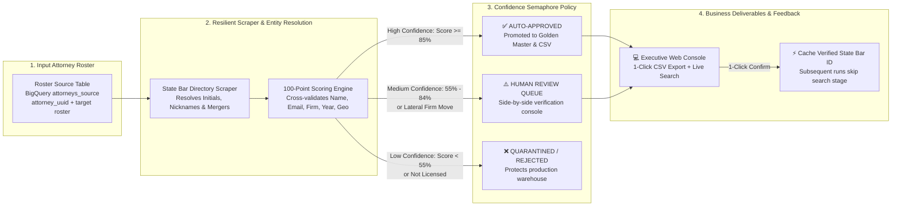
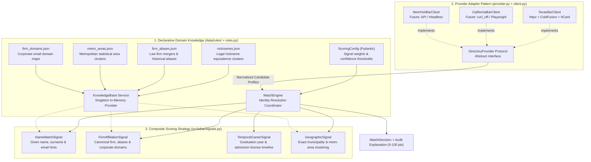
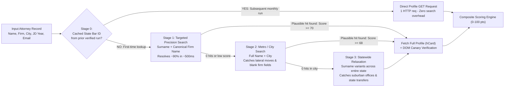
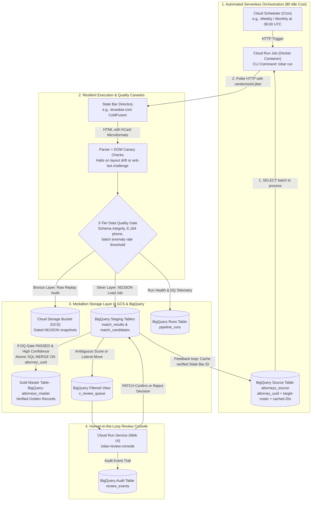

# System Architecture & Technical Diagrams (English)
## Multi-State Bar Attorney Enrichment & Identity Resolution Pipeline

This document provides four self-contained, presentation-ready architectural diagrams for the attorney enrichment and entity resolution pipeline built for **Recruiter BackOffice (RBO)**. The diagrams illustrate the general production design for recurring batch runs at scale across state bar directories.

---

## 📊 Diagram 1: Executive Overview & Confidence Semaphore
### Target Audience: CEO, Executive Leadership & Business Stakeholders

Visualizes the end-to-end business pipeline from input roster to enriched delivery, highlighting the 3-tier confidence policy, the executive review console, and the self-accelerating State Bar ID feedback loop.

### Architectural Principles:
1. **High Auto-Verification Policy ($\ge 85\%$)**: Roster attorneys with unambiguous multi-signal confidence are automatically enriched and promoted to golden master records, extracting direct E.164 phone numbers with zero human overhead.
2. **Conservative Quarantine Tier ($55\text{--}84\%$)**: Holds ambiguous matches and **detected lateral firm moves** for rapid one-click confirmation in the review console.
3. **Data Quality Protection ($< 55\%$)**: Quarantines unmatched or unverified candidates to prevent polluting production CRM/ATS tables with false positives.
4. **Self-Accelerating Feedback Loop**: Caches verified State Bar IDs back into BigQuery source tables, cutting future HTTP traffic by ~50% on subsequent monthly runs.
*(Benchmark note: On the 100-attorney validation batch, this model achieved a 95.0% auto-approval rate, extracted 81 direct phone numbers, and surfaced 1 lateral firm move).*

---

## 🛠️ Diagram 2: Internal Engine Architecture & Extensible Design Patterns
### Target Audience: IT Lead, Lead Software Architect & Backend Engineers

Illustrates how the codebase decouples state directory HTTP clients, declarative business rules, and multi-signal scoring algorithms to scale seamlessly from 1 state to 50+ state bar associations.

### Key Design Patterns:
1. **Provider Adapter Pattern (`DirectoryProvider Protocol`)**: Decouples the matching engine from website-specific protocols. Adding California or New York requires only a new adapter; matching logic, DQ gates, and BigQuery schemas remain 100% untouched.
2. **Declarative Data-Driven Configuration (`KnowledgeBase`)**: Domain rules are externalized in JSON files (`nicknames.json`, `firm_aliases.json`, `metro_areas.json`, `firm_domains.json`). Recruiter domain knowledge is updated without modifying Python code.
3. **Composite Scoring Strategy (`ScoringSignal Protocol`)**: Evaluates identity across 4 independent, testable signals (`NameMatchSignal`, `FirmAffiliationSignal`, `TemporalCareerSignal`, `GeographicSignal`), configured via a Pydantic `ScoringConfig`.
4. **Dependency Injection**: The `Pipeline` accepts an injected `DirectoryProvider` and `StorageBackend`, enabling comprehensive unit tests to run in <0.3s without external HTTP dependencies.

---

## 🔍 Diagram 3: 4-Stage Waterfall Search Algorithm
### Target Audience: Web Scraping Engineers & Data Pipeline Reviewers (Questions 2 & 3)

Details how the scraper queries state bar directories efficiently without wasting HTTP requests or getting tripped up by initials, suffixes, or firm relocations.

### Waterfall Progression:
1. **Stage 0 (Cached Direct Profile Lookup)**: Uses verified State Bar ID (`ContactID` / `BarCardNumber`) from prior runs. Takes 1 HTTP request and bypasses the search engine entirely.
2. **Stage 1 (Surname + Canonical Firm)**: Submits `Name = <LastName>` and `CompanyName = <FirmCore>`. Resolves ~90% of lawyers on the first attempt and naturally solves first-name initials (e.g., `W. Buechele` $\rightarrow$ *William 'Bryant Buechele' Buechele*).
3. **Stage 2 (Full Name + City)**: Fallback when Stage 1 yields 0 hits because the attorney left their firm blank on the directory or switched law firms (lateral move).
4. **Stage 3 (Statewide Relaxation)**: Fallback when the attorney's physical office is registered in a suburban municipality outside the main metropolitan hub.
5. **DOM Canary Verification**: Every response is verified for semantic microformats or official "No results" landmarks. Any structural layout shift raises `DomDriftError`, halting execution before invalid data can enter BigQuery.

---

## ☁️ Diagram 4: Cloud-Native GCP Infrastructure & BigQuery Medallion Architecture
### Target Audience: Cloud Engineers, Data Platform Leads & SecOps (Questions 4, 5 & 6)

Shows the automated serverless deployment on Google Cloud Platform, the 3-tier Data Quality gate, and the Medallion lakehouse pattern in BigQuery.

### Production & Governance Details:
1. **Serverless & Zero Idle Cost**: The enricher runs as a **Cloud Run Job** invoked by **Cloud Scheduler**. When no batch is running, compute resources shut down completely ($0 idle cost).
2. **Medallion Data Architecture**:
   - **Bronze (GCS)**: Raw NDJSON responses saved to date-partitioned buckets for compliance and historical replay.
   - **Silver (BigQuery `match_results` & `match_candidates`)**: Staging layer loaded via **BigQuery Load Jobs** (avoiding streaming buffer locks that prevent immediate `UPDATE`/`MERGE`).
   - **Gold (BigQuery `attorneys_master`)**: Verified records updated atomically via `MERGE ON target.attorney_uuid = source.attorney_uuid`.
3. **3-Tier Data Quality Gate**:
   - **Field Level**: License numbers strictly validated as string formats to preserve leading zeros on legacy licenses; phone formatted to NANP E.164 (`+1XXXXXXXXXX`).
   - **Cross-Validation**: Temporal plausibility check between law school graduation and admission date.
   - **Batch Level**: Halts promotion to `attorneys_master` if the anomaly/not-found rate exceeds the configured threshold (e.g., 20%).
4. **Human Review Console**: Deployed on Cloud Run (`txbar-review-console`), allowing recruiters to review ambiguous records, inspect side-by-side signal breakdowns, and download the enriched delivery CSV with one click.
