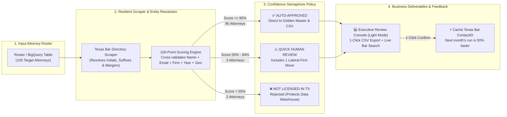
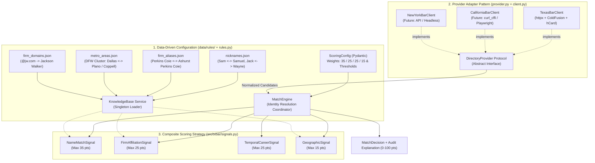

# System Architecture & Technical Diagrams (English)
## Texas Bar Attorney Enrichment & Identity Resolution Pipeline

This document provides four self-contained, presentation-ready architectural diagrams for the Texas Bar enrichment pipeline built for **Recruiter BackOffice (RBO)**. 

---

## 📊 Diagram 1: Executive Overview & Confidence Semaphore
### Target Audience: CEO, Executive Leadership & Business Stakeholders

Visualizes the end-to-end business pipeline from input roster to enriched delivery, highlighting the 3-tier traffic-light confidence policy, the light-mode review console, and the self-accelerating `ContactID` feedback loop.



### Executive Highlights:
1. **High Auto-Verification Rate (95.0%)**: 95 out of 100 attorneys are resolved automatically with scores $\ge 85\%$, extracting 81 direct, E.164-standardized phone numbers with zero human intervention.
2. **Conservative Quarantine (3.0%)**: Only 3 ambiguous profiles are held for human review. Crucially, **1 of these 3 is a high-value Lateral Firm Move** (*Joshua Michaels*, who switched from *Buchalter PC* to *Griffith Davison*).
3. **Data Warehouse Protection (2.0%)**: Erroneous candidates (< 55%) are rejected automatically (e.g., rejecting a 1998 municipal prosecutor sharing the name *Christie Westmoreland*).
4. **The "Second-Run" Performance Multiplier**: Confirming an attorney caches their official Texas Bar `ContactID` back into BigQuery (`attorneys_source`). Subsequent runs skip the search form entirely and query the profile directly, cutting HTTP requests by 50% and eliminating homonym ambiguity forever.

---

## 🛠️ Diagram 2: Internal Engine Architecture & Extensible Design Patterns
### Target Audience: IT Lead, Lead Software Architect & Backend Engineers

Illustrates how the codebase decouples state directory HTTP clients, declarative business rules, and multi-signal scoring algorithms to scale seamlessly from 1 state to 50+ state bar associations.



### Key Design Patterns:
1. **Provider Adapter Pattern (`DirectoryProvider Protocol`)**: Decouples the matching engine from website-specific protocols. Adding California or New York requires only a new adapter; matching logic, DQ gates, and BigQuery schemas remain 100% untouched.
2. **Declarative Data-Driven Configuration (`KnowledgeBase`)**: Domain rules are externalized in JSON files (`nicknames.json`, `firm_aliases.json`, `metro_areas.json`, `firm_domains.json`). Recruiter domain knowledge is updated without modifying Python code.
3. **Composite Scoring Strategy (`ScoringSignal Protocol`)**: Evaluates identity across 4 independent, testable signals (`NameMatchSignal`, `FirmAffiliationSignal`, `TemporalCareerSignal`, `GeographicSignal`), configured via a Pydantic `ScoringConfig`.
4. **Dependency Injection**: The `Pipeline` accepts an injected `DirectoryProvider` and `StorageBackend`, enabling 29 unit tests to run in <0.3s without external HTTP dependencies.

---

## 🔍 Diagram 3: 4-Stage Waterfall Search Algorithm
### Target Audience: Web Scraping Engineers & Data Pipeline Reviewers (Questions 2 & 3)

Details how the scraper queries the Texas Bar directory efficiently without wasting HTTP requests or getting tripped up by initials, suffixes, or firm relocations.

```mermaid
flowchart LR
    IN["Input Attorney Record<br/>(Name, Firm, City, JD Year, Email)"] --> S0{"Stage 0:<br/>Cached ContactID from<br/>prior verified run?"}
    
    S0 -->|YES: Subsequent monthly run| DIRECT["Direct Profile GET Request<br/>(1 HTTP req - Zero search overhead)"]
    
    S0 -->|NO: First-time lookup| S1["Stage 1: Targeted Precision Search<br/>Surname + Firm Core<br/>(e.g., 'Buechele' + 'Winstead')"]
    
    S1 -->|Plausible hit found (Score >= 70)| EVAL["Fetch Full Profile (hCard)<br/>+ DOM Canary Check"]
    
    S1 -->|0 hits or low score<br/>(Blank firm or lateral move)| S2["Stage 2: Metro / City Search<br/>Full Name + City<br/>(e.g., 'Zackary Callarman' + 'Dallas')"]
    
    S2 -->|Plausible hit found (Score >= 68)| EVAL
    
    S2 -->|0 hits in city<br/>(Suburban office or statewide move)| S3["Stage 3: Statewide Relaxation<br/>Surname variants across all Texas<br/>(e.g., 'Aileen Glaeser' in Coppell, TX)"]
    
    S3 --> EVAL
    DIRECT --> SCORE["Composite Scoring Engine (0-100 pts)"]
    EVAL --> SCORE
```

### Waterfall Progression:
1. **Stage 0 (Cached Direct Profile Lookup)**: Uses verified `txbar_contact_id` from prior runs. Takes 1 HTTP request and bypasses the search engine entirely.
2. **Stage 1 (Surname + Canonical Firm)**: Submits `Name = <LastName>` and `CompanyName = <FirmCore>`. Resolves 90% of lawyers in ~500ms and naturally solves first-name initials (e.g., finding *William 'Bryant Buechele' Buechele* for input `W. Buechele`).
3. **Stage 2 (Full Name + City)**: Fallback when Stage 1 yields 0 hits because the attorney left their firm blank on the Bar site (*Zackary Callarman*) or switched law firms (*Joshua Michaels*).
4. **Stage 3 (Statewide Relaxation)**: Fallback when the attorney's physical office is registered in a suburban municipality outside the main metropolitan city (*Aileen Glaeser* in Coppell, TX).
5. **DOM Canary Verification**: Every response is verified for semantic `hCard` microformats or official "No results" landmarks. Any structural layout shift raises `DomDriftError`, halting execution before invalid data can enter BigQuery.

---

## ☁️ Diagram 4: Cloud-Native GCP Infrastructure & BigQuery Medallion Architecture
### Target Audience: Cloud Engineers, Data Platform Leads & SecOps (Questions 4, 5 & 6)

Shows the automated serverless deployment on Google Cloud Platform, the 3-tier Data Quality gate, and the Medallion lakehouse pattern in BigQuery.

```mermaid
flowchart TD
    subgraph Trigger["1. Automated Serverless Orchestration ($0 Idle Cost)"]
        CRON["Cloud Scheduler (Cron)<br/>e.g., Weekly / Monthly at 06:00 UTC"] -->|HTTP Trigger| JOB["Cloud Run Job (Docker Container)<br/>CLI Command: txbar run"]
        BQS[("BigQuery Source Table:<br/>attorneys_source<br/>(attorney_uuid + roster + cached ContactIDs)")] -->|1. SELECT batch to process| JOB
    end

    subgraph Execution["2. Resilient Execution & Quality Canaries"]
        JOB -->|2. Polite HTTP (1.2s - 2.8s jitter)| WEB["State Bar of Texas Directory<br/>(texasbar.com ColdFusion)"]
        WEB -->|HTML with hCard Microformats| PARSE["Selectolax Parser + DOM Canary<br/>(Halts on anti-bot or layout shift)"]
        PARSE --> DQ{"3-Tier Data Quality Gate<br/>(8-digit Bar string, E.164 phone,<br/>not_found ratio < 20%)"}
    end

    subgraph Medallion["3. Medallion Storage Layer in GCS & BigQuery"]
        DQ -->|Bronze Layer: Raw Replay Audit| GCS[("Cloud Storage Bucket (GCS)<br/>Dated .ndjson snapshots")]
        DQ -->|Silver Layer: NDJSON Load Job| BQR[("BigQuery Staging Tables:<br/>match_results & match_candidates")]
        DQ -->|Run Health & DQ Telemetry| BQP[("BigQuery Runs Table:<br/>pipeline_runs")]
        
        BQR -->|If DQ Gate = PASSED & Score >= 85%<br/>Atomic SQL MERGE ON attorney_uuid| BQM[("Gold Master Table - BigQuery:<br/>attorneys_master<br/>(Verified Golden Records)")]
        BQR -->|Feedback loop: Cache verified ContactID| BQS
        BQR -->|Score 55-84% or Lateral Move| BQV[("BigQuery Filtered View:<br/>v_review_queue")]
    end

    subgraph HITL["4. Human-in-the-Loop Review Console"]
        BQV --> UI["Cloud Run Service (Web UI)<br/>txbar-review-console"]
        UI -->|PATCH Confirm / Reject Decision| BQR
        UI -->|Audit Event Trail| BQE[("BigQuery Audit Table:<br/>review_events")]
    end
```

### Production & Governance Details:
1. **Serverless & Zero Idle Cost**: The enricher runs as a **Cloud Run Job** invoked by **Cloud Scheduler**. When no batch is running, compute resources shut down completely ($0 idle cost).
2. **Medallion Data Architecture**:
   - **Bronze (GCS)**: Raw NDJSON responses saved to date-partitioned buckets for compliance and historical replay.
   - **Silver (BigQuery `match_results` & `match_candidates`)**: Staging layer loaded via **BigQuery Load Jobs** (avoiding streaming buffer locks that prevent immediate `UPDATE`/`MERGE`).
   - **Gold (BigQuery `attorneys_master`)**: Verified records updated atomically via `MERGE ON target.attorney_uuid = source.attorney_uuid`.
3. **3-Tier Data Quality Gate**:
   - **Field Level**: `bar_card_number` strictly validated as an **8-digit `STRING`** (preventing integer truncation of leading zeros on legacy licenses, e.g., `02277280`); phone formatted to NANP E.164 (`+1XXXXXXXXXX`).
   - **Cross-Validation**: Temporal plausibility check between law school graduation and admission date.
   - **Batch Level**: Halts promotion to `attorneys_master` if the `not_found_ratio` exceeds 20%.
4. **Human Review Console**: Deployed on Cloud Run (`txbar-review-console`), allowing recruiters to review ambiguous records, inspect side-by-side signal breakdowns, and download the enriched delivery CSV with one click.
