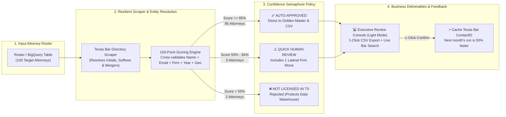
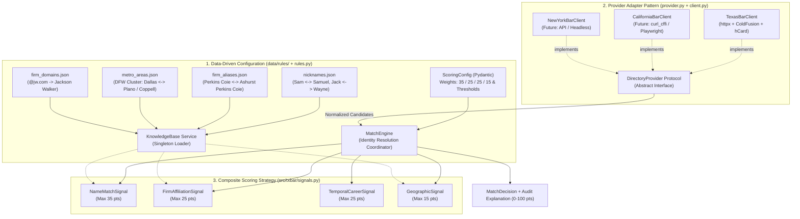

# Manual Maestro Definitivo: Arquitectura, Detrás de Escena, Casos Reales y Discurso en Inglés (RBO Challenge)

Este es tu **documento único y definitivo de estudio**. Acá está **absolutamente todo** sin resumir ni omitir nada:
1. **Tu Forma de Pensamiento y el "Choque Cultural" con los datos de EE. UU.** (cómo exploraste el problema en la vida real).
2. **Los Diagramas Completos**:
   - **Diagrama 1 (Dirigido al CEO)**: Visión de Negocio, Semáforo de Decisiones y Flujo End-to-End.
   - **Diagrama 2 (Dirigido al Ingeniero de IT — Parte A)**: Arquitectura Interna del Motor y Patrones de Diseño (para escalar de Texas a 50+ estados).
   - **Diagrama 3 (Dirigido al Ingeniero de IT — Parte B)**: Algoritmo de Búsqueda en Cascada (*4-Stage Waterfall Lookup*).
   - **Diagrama 4 (Dirigido al Ingeniero de IT — Parte C)**: Infraestructura en Google Cloud Platform (GCP) y BigQuery (*Medallion Architecture*).
3. **El Detrás de Escena y Patrones de Diseño**: Cómo funciona cada archivo del repositorio, por qué se modularizó así, cómo leer el código y cómo se conecta todo con todo.
4. **Los 6 Casos de Uso Reales Paso a Paso**: Cómo el scraper busca, puntúa, desempata homónimos y descarta falsos positivos (*W. Buechele*, *Michael L. Roberts*, *Joshua Michaels*, *Rachel Boyce*, *Aileen Glaeser*, *Christie Westmoreland*).
5. **Las 6 Respuestas al Mail de RBO explicadas a fondo**.
6. **El Discurso Completo 100% en Inglés (Word-for-Word Script)** listo para hablar con el CEO y con el de IT, más posibles preguntas trampa y plantilla de mail.

---

# SECCIÓN 1: Tu Forma de Pensamiento y el "Choque Cultural" (Exploración del Dataset)

Antes de tirar una sola línea de código, hiciste lo que hace un ingeniero de datos senior: **explorar el Excel de 100 abogados (`tx_lawyers.csv`) y probar búsquedas manuales en la web real (`texasbar.com`)**.

Al venir de afuera de EE. UU., te encontraste con un verdadero **"choque cultural y de datos"** propio del mercado legal norteamericano. Si hubieras armado un scraper ingenuo que simplemente copiara y pegara el `Name` del Excel en la web del Bar, **habrías fallado en más del 30% de la lista**.

Estas son las **6 realidades del mundo real** que descubriste explorando los datos y que moldearon tu arquitectura:

### 1. La costumbre estadounidense de abreviar el primer nombre y usar el *Middle Name* (`W. Buechele`)
- **En Latinoamérica**: Si alguien se llama *William Bryant Buechele*, todo el mundo lo llama *William*.
- **En EE. UU.**: Es sumamente común que los profesionales escriban su primer nombre legal como una inicial (`W.`) y en la vida diaria usen su segundo nombre (*middle name*: **`Bryant`**).
- **Qué viste en el Excel (Fila 21)**:
  - Nombre: `W. Buechele` | Estudio: `Winstead PC` | Ciudad: `Dallas` | Email: `bbuechele@winstead.com`.
  - ¡Mirá el email! Empieza con **`b`** (`bbuechele`), no con `w`.
- **Qué pasaba en la web de Texas Bar**: Si escribís `"W. Buechele"` en el buscador de `texasbar.com`, **devuelve 0 resultados**, porque el formulario viejo en ColdFusion no entiende iniciales con punto.
- **Qué descubriste**: Al buscarlo por apellido (`Buechele`) + firma (`Winstead`), apareció su ficha oficial: **`William 'Bryant Buechele' Buechele`**. El Bar de Texas pone entre comillas simples el nombre que el abogado usa comercialmente (`preferred_name`). Ahí entendiste que tenías que extraer el texto entre comillas y cruzarlo con la primera letra del email (`b` = `Bryant`).

### 2. Los Sufijos Dinásticos (`III`, `IV`, `Jr.`) y los Apodos Tradicionales (`Wayne` $\rightarrow$ `Jack`)
- **Qué viste en el Excel**: Abogados con números romanos en el nombre, muy típico de familias tradicionales en EE. UU.:
  - `Wayne Zeringue III` (Sidley Austin, email: `jzeringue@sidley.com`)
  - `Reymundo Rodriguez IV` (Foley & Lardner, email: `rrodriguez@foley.com`)
  - `Theodore N. McDowell III` (Jackson Walker, email: `tmcdowell@jw.com`)
- **El problema real**: Si no separás el `III` o `IV` antes de analizar el nombre, un programa común piensa que el apellido de la persona es `"Zeringue III"` y la búsqueda falla.
- **El segundo choque cultural**: ¿Por qué el email de *Wayne Zeringue III* empieza con **`j`** (`jzeringue@sidley.com`)? Cuando abriste su ficha en el Bar de Texas, decía `Wayne 'Jack' Zeringue III`. En EE. UU. muchos usan apodos formales registrados en el Bar (`Jack`, `Taylor`, `Sam` por `Samuel`, `Brent` por `Brenton`, `Rey` por `Reymundo`).

### 3. Nombres Compuestos Anglosajones vs. Doble Apellido Hispano (`Mary Anna Rutledge` vs. `Luisa Gutierrez Quintero`)
- **El problema real**: En EE. UU. la regla general es `Primer Nombre` + `Segundo Nombre` + `1 solo Apellido`. Pero en **Texas** hay muchísimos abogados de origen hispano que usan **dos apellidos sin guion**.
- **Qué viste en el Excel**: Tenías nombres de 3 palabras de los dos tipos:
  - `Mary Anna Rutledge` (email: `mrutledge@porterhedges.com`) $\rightarrow$ Acá *Anna* es segundo nombre y el apellido es solo **`Rutledge`**.
  - `Luisa Gutierrez Quintero` (email: `lgutierrezquintero@kslaw.com`) $\rightarrow$ Acá **`Gutierrez Quintero`** son dos apellidos. Si buscás solo `"Quintero"` como apellido, perdés el apellido principal.
- **Tu idea brillante**: Usaste el **prefijo del email corporativo** como "detector de apellidos". En [`normalize.py`](file:///Users/sebiporini/Documents/Repositorios/Personal/attorney-scrapper/src/txbar/normalize.py#L140), tu función `parse_input_name(name, email)` mira `lgutierrezquintero@`: como ve que después de la `l` están pegados `gutierrez` y `quintero`, se da cuenta automáticamente de que el apellido es compuesto (`Gutierrez Quintero`). En cambio, en `mrutledge@`, ve que solo está `rutledge`, así que sabe que `Anna` es el *middle name*.

### 4. El "Sprawl" Urbano de Texas (La Gran Ciudad del Reclutador vs. el Municipio de la Oficina)
- **El problema real**: Para una consultora de reclutamiento como RBO, en el Excel siempre anotan el gran mercado: **`Dallas`**, **`Houston`** o **`Austin`**.
- Pero las ciudades de Texas son manchas urbanas gigantescas (*DFW Metroplex* o *Greater Houston*) formadas por decenas de municipios pegados.
- **Qué viste en el Excel**: A **`Aileen Glaeser`** la planilla la ubicaba en **`Dallas`**, pero en el padrón oficial del Bar de Texas su oficina está registrada en **`Coppell, TX`** (un suburbio pegado a Dallas, a 15 minutos del centro).
- **Tu solución**: Armaste un mapa de **Áreas Metropolitanas** ([`metro_areas.json`](file:///Users/sebiporini/Documents/Repositorios/Personal/attorney-scrapper/data/rules/metro_areas.json)) donde `Dallas`, `Plano`, `Coppell`, `Irving`, `Frisco`, `Richardson` y `Fort Worth` pertenecen al mismo clúster (`dfw`). Así, si buscás en Dallas y no sale, abrís la búsqueda al estado y el motor de puntaje reconoce que *Coppell* es parte del Gran Dallas (dándole 13.5 de los 15 puntos geográficos en vez de castigarla).

### 5. El Federalismo Legal en EE. UU.: Año de Graduación (`JD Year`) $\neq$ Año de Matrícula en Texas
- **El problema real**: En EE. UU. la matrícula de abogado no es nacional, es **por estado**. Muchos abogados de estudios grandes (*BigLaw*) se reciben en la universidad en Nueva York o California en **2018** (`JD Year = 2018`), trabajan allá unos años, y cuando su firma los traslada a la oficina de Houston o Dallas en **2024 o 2025**, recién ahí sacan la licencia de Texas (*Texas License Date = 2025*, como el caso real de **Patrick Dolan** en tu planilla).
- **Tu solución**: En la ficha del Bar de Texas aparecen **dos fechas distintas**: la fecha en que se matriculó en Texas (`License Date`) y el año en que se graduó de la facultad de derecho (`Law School Graduation Date`). Tu parser extrae **ambas fechas**, y tu señal temporal ([`signals.py`](file:///Users/sebiporini/Documents/Repositorios/Personal/attorney-scrapper/src/txbar/signals.py#L315)) compara el `JD Year` del Excel contra **cualquiera de las dos**, con tolerancia de $\pm 1$ o $\pm 2$ años.

### 6. Tu Gran Descubrimiento de Calidad de Datos: La Anomalía del `JD Year = 2017`
- **Qué descubriste haciendo profiling del Excel**:
  Contaste cuántos abogados había por cada `JD Year` en el archivo de 100 abogados y viste algo estadísticamente imposible: **43 de los 100 abogados tenían `JD Year = 2017`**, y dentro de esos 43 había **21 Partners (Socios)** de firmas de primer nivel (Sidley Austin, Kirkland, Jackson Walker, Haynes and Boone).
- **Por qué es imposible en la vida real**: En las grandes firmas de EE. UU. (*BigLaw*), llegar a Partner lleva entre 8 y 12 años de carrera. En efecto, cuando buscaste a esos socios en el Bar (por ejemplo, **J.W. Beverly**, Partner de Dow Golub, o **Reece Rondon**, Partner de Kang Haggerty), viste que se habían recibido en **2000** y **1995**, ¡no en 2017!
- **Tu conclusión de negocio**: En la base de datos interna de donde RBO exportó esta muestra, alguien le clavó `2017` como valor por defecto (*default value*) a todos los perfiles a los que les faltaba el año de graduación.
- **Tu decisión arquitectónica**: Si hubieras programado el scraper diciendo `WHERE graduation_year == jd_year`, habrías rechazado a 21 socios verdaderos. Por eso decidiste que el `JD Year` sea una **señal blanda que suma puntos**, y cuando el Nombre, la Firma y la Ciudad coinciden al 100% en una fila que dice `2017`, el motor aplica un piso de seguridad temporal para que igualmente supere los 85 puntos y se auto-apruebe. *(Mencionar esto en la entrevista les demuestra que no solo programás, sino que auditás y entendés sus datos mejor que nadie).*

---

# SECCIÓN 2: Los Diagramas Completos (Para el CEO y para el Ingeniero de IT)

Acá tenés los diagramas divididos según **a quién le estás hablando**. Antes sentías que faltaba el diagrama general porque en el README original había uno gigante y en la guía habíamos dejado el interno. Acá están **todos**, explicados paso a paso.

---

## 📊 DIAGRAMA 1 (Dirigido al CEO): Flujo de Negocio, Semáforo de Confianza y Valor Comercial

### ¿Cuándo usar este diagrama?
Cuando hablás con el **CEO**. A él no le importa cómo se llama una clase en Python ni qué librería parsea el HTML; a él le importa:
1. **¿De dónde salen los abogados y cuántos teléfonos consigo?** (95% verificados automáticamente, 82 teléfonos directos).
2. **¿Cómo sé que no me mezclaste a un Juan Pérez con otro?** (El Semáforo de Confianza de 0 a 100%).
3. **¿Qué valor extra me da esto para mi negocio de reclutamiento?** (Detecta cuando un abogado se mudó de estudio jurídico —*Lateral Move*— y guarda el ID oficial para que el mes que viene cueste la mitad).



### Cómo leer y explicar el Diagrama del CEO en 60 segundos:
1. **Izquierda (Entrada)**: *"Recibimos la lista de 100 abogados (hoy desde el CSV, y en producción directamente desde su tabla en BigQuery)."*
2. **Centro (El Motor Inteligente)**: *"El sistema busca a cada abogado en el Colegio de Abogados de Texas resolviendo los problemas reales de nombres (iniciales, apodos, fusiones de firmas) y le calcula un **puntaje de seguridad de 0 a 100%** para estar 100% seguros de que es la misma persona y no un homónimo."*
3. **Derecha (El Semáforo de 3 Colores)**:
   - **Verde ($\ge 85\%$, 95 abogados)**: *"Estamos 100% seguros. Pasan directo sin hacerle perder tiempo a nadie. De acá sacamos 81/82 teléfonos directos listos para llamar."*
   - **Amarillo ($55\%\text{--}84\%$, 3 abogados)**: *"En vez de adivinar, el sistema frena solo los 3 casos dudosos para que un humano los confirme en 10 segundos en la pantalla web. Y acá aparece algo valiosísimo para RBO: detectamos a **Joshua Michaels**, que sigue siendo el mismo abogado pero **se mudó de Buchalter a Griffith Davison** (un Lateral Move)."*
   - **Rojo ($< 55\%$, 2 abogados)**: *"No están matriculados en Texas (*Breegan Mayrant* y *Christie Westmoreland*). El sistema los frena para no meter teléfonos falsos en su base."*
4. **Cierre (Consola Web + Efecto Bola de Nieve)**: *"Todo esto se ve en la web en modo claro que desplegué en Google Cloud Run, donde pueden bajar el CSV con un clic y, como guardamos el número de legajo interno del Bar (`ContactID`), la próxima vez que corra va directo al hueso en la mitad de tiempo."*

---

## 🛠️ DIAGRAMA 2 (Dirigido al Ingeniero de IT — Parte A): Arquitectura Interna del Código y Patrones de Diseño

### ¿Cuándo usar este diagrama?
Cuando el **Ingeniero de IT** (o tu amigo) te pregunte cómo organizaste el código en Python y **cómo pensás escalar esto de 1 página (Texas) a 50 o 200 colegios de abogados distintos** sin que el proyecto se vuelva una bola de espagueti inmanejable.



### Explicación profunda de los 4 Patrones de Diseño que usaste acá:

1. **Data-Driven Configuration (Reglas Declarativas Externas — Caja 1)**:
   - *El problema*: Muchos programadores llenan el código de `if firm == "Perkins Coie" or firm == "Ashurst Perkins Coie":`. Eso es código sucio (*hardcoding*).
   - *Tu solución*: Sacaste todo el conocimiento del mundo legal a 4 archivos `.json` en [`data/rules/`](file:///Users/sebiporini/Documents/Repositorios/Personal/attorney-scrapper/data/rules) y creaste el servicio [`KnowledgeBase`](file:///Users/sebiporini/Documents/Repositorios/Personal/attorney-scrapper/src/txbar/rules.py#L22).
   - *Por qué brilla para RBO*: Esos 4 JSON son **universales para todo Estados Unidos**. Un estudio jurídico como *Kirkland & Ellis* o *Sidley Austin*, o un apodo como *Sam / Samuel*, es idéntico en Texas, California, Florida o Nueva York. Cuando RBO agregue 50 estados más, esos diccionarios ya están listos.
2. **Adapter / Provider Pattern (`DirectoryProvider Protocol` — Caja 2)**:
   - *El problema*: La web de Texas está hecha en Adobe ColdFusion y devuelve HTML con microformatos `hCard`. La de California puede ser una API JSON, y la de otro estado puede tener Cloudflare y requerir `curl_cffi` o `Playwright`.
   - *Tu solución*: Definiste una interfaz formal ([`DirectoryProvider`](file:///Users/sebiporini/Documents/Repositorios/Personal/attorney-scrapper/src/txbar/provider.py#L71) usando `typing.Protocol`). El motor de búsqueda no sabe nada de HTML ni de ColdFusion: solo pide `search_targeted()`, `search_by_city()`, `search_statewide()` y `get_directory_profile()`, y recibe objetos limpios (`DirectoryHit` y `DirectoryProfile`).
   - *Por qué brilla para RBO*: Para agregar el estado #2 (ej. California), solo escribís `CaliforniaBarClient` implementando esas 4 funciones. **No tenés que tocar ni una línea del motor de scoring, ni de los controles de calidad, ni de BigQuery.**
3. **Composite Strategy Pattern (`ScoringSignal` — Caja 3)**:
   - *El problema*: Si calculás los 100 puntos adentro de una sola función gigante de 500 líneas, es imposible de testear y cualquier cambio rompe todo.
   - *Tu solución*: En [`src/txbar/signals.py`](file:///Users/sebiporini/Documents/Repositorios/Personal/attorney-scrapper/src/txbar/signals.py) dividiste el puntaje en **4 clases independientes** que implementan el protocolo `ScoringSignal`:
     1. [`NameMatchSignal`](file:///Users/sebiporini/Documents/Repositorios/Personal/attorney-scrapper/src/txbar/signals.py#L94) (35 puntos)
     2. [`FirmAffiliationSignal`](file:///Users/sebiporini/Documents/Repositorios/Personal/attorney-scrapper/src/txbar/signals.py#L229) (25 puntos)
     3. [`TemporalCareerSignal`](file:///Users/sebiporini/Documents/Repositorios/Personal/attorney-scrapper/src/txbar/signals.py#L315) (25 puntos)
     4. [`GeographicSignal`](file:///Users/sebiporini/Documents/Repositorios/Personal/attorney-scrapper/src/txbar/signals.py#L390) (15 puntos)
   - Y los pesos están gobernados por un modelo Pydantic ([`ScoringConfig`](file:///Users/sebiporini/Documents/Repositorios/Personal/attorney-scrapper/src/txbar/signals.py#L33)).
4. **Dependency Injection & Repository Pattern (`Pipeline` y `StorageBackend`)**:
   - Tanto [`Pipeline`](file:///Users/sebiporini/Documents/Repositorios/Personal/attorney-scrapper/src/txbar/pipeline.py#L34) como la API web reciben el `StorageBackend` ([`CsvStorageBackend`](file:///Users/sebiporini/Documents/Repositorios/Personal/attorney-scrapper/src/txbar/storage.py#L51) o [`BigQueryStorageBackend`](file:///Users/sebiporini/Documents/Repositorios/Personal/attorney-scrapper/src/txbar/storage.py#L286)) y el `DirectoryProvider` por **inyección de dependencias**.
   - Eso permite correr los **29 tests unitarios en 0.15 segundos sin internet**, inyectando un proveedor simulado (`FakeDirectoryProvider` en [`tests/test_pipeline_di.py`](file:///Users/sebiporini/Documents/Repositorios/Personal/attorney-scrapper/tests/test_pipeline_di.py)), y permite cambiar de archivos CSV locales a Google BigQuery cambiando una sola variable de entorno (`STORAGE_BACKEND=bigquery`).

---

## 🔍 DIAGRAMA 3 (Dirigido al Ingeniero de IT — Parte B): El Algoritmo de Búsqueda en Cascada (*4-Stage Waterfall Lookup*)

### ¿Cuándo usar este diagrama?
Para responder la **Pregunta 2** (*cómo funciona el scraper*) y la **Pregunta 3** (*cómo corre eficientemente en ejecuciones futuras sin saturar la web*). Está implementado en [`MatchEngine.resolve_attorney`](file:///Users/sebiporini/Documents/Repositorios/Personal/attorney-scrapper/src/txbar/matching.py#L186).

```mermaid
flowchart LR
    IN["Input Attorney Record<br/>(Name, Firm, City, JD Year, Email)"] --> S0{"Stage 0:<br/>Cached ContactID from<br/>prior verified run?"}
    
    S0 -->|YES: Subsequent monthly run| DIRECT["Direct Profile GET Request<br/>(1 HTTP req - Zero search overhead)"]
    
    S0 -->|NO: First-time lookup| S1["Stage 1: Targeted Precision Search<br/>Surname + Firm Core<br/>(e.g., 'Buechele' + 'Winstead')"]
    
    S1 -->|Plausible hit found (Score >= 70)| EVAL["Fetch Full Profile (hCard)<br/>+ DOM Canary Check"]
    
    S1 -->|0 hits or low score<br/>(Blank firm or lateral move)| S2["Stage 2: Metro / City Search<br/>Full Name + City<br/>(e.g., 'Zackary Callarman' + 'Dallas')"]
    
    S2 -->|Plausible hit found (Score >= 68)| EVAL
    
    S2 -->|0 hits in city<br/>(Suburban office or statewide move)| S3["Stage 3: Statewide Relaxation<br/>Surname variants across all Texas<br/>(e.g., 'Aileen Glaeser' in Coppell, TX)"]
    
    S3 --> EVAL
    DIRECT --> SCORE["Composite Scoring Engine (0-100 pts)"]
    EVAL --> SCORE
```

### Por qué este diseño en 4 etapas es tan inteligente:
- **Etapa 0 (El multiplicador de velocidad para la 2da corrida)**: La primera vez que buscamos a los 100 abogados, necesitamos buscar en el formulario y luego abrir la ficha (~2 peticiones HTTP por abogado). Pero una vez que confirmamos que *Jason Burner* es el `ContactID = 343305`, guardamos ese ID en la tabla `attorneys_source`. El mes que viene, cuando corra el refresco mensual, **entra por la Etapa 0**: va directo a `MemberDirectoryDetail.cfm&ContactID=343305`. Tarda la mitad, hace la mitad de peticiones HTTP y **nunca más puede confundirse de homónimo**.
- **Etapa 1 (`Apellido + Firma`)**: Es el secreto por el cual resolvemos rápido apellidos comunes y nombres con iniciales como `W. Buechele`. Si buscás `"Roberts"` en todo Texas salen cientos y la página las pagina de a 25; pero si buscás `Name = Roberts` + `CompanyName = Sidley`, el servidor de Texas filtra en su base de datos y te devuelve **1 solo resultado en medio segundo**.
- **Etapa 2 (`Nombre + Ciudad`)**: ¿Por qué a veces la Etapa 1 da 0 resultados? Por dos motivos reales que vimos en el dataset:
  1. Porque el abogado **no completó el campo opcional "Empresa"** en la web del Bar (ej. *Zackary Callarman* o *Mitchell Alleluia-Feinberg*).
  2. Porque el abogado **se cambió de estudio jurídico** (*Joshua Michaels* ya no está en Buchalter, ahora está en Griffith Davison).
  Al caer automáticamente a la Etapa 2 (buscando por nombre y ciudad sin exigir la empresa), los atrapamos igual.
- **Etapa 3 (`Relajación a todo el Estado de Texas`)**: Si tampoco apareció en esa ciudad (porque en el Excel decía *Dallas* pero su oficina está en el municipio vecino de *Coppell*, como *Aileen Glaeser*, o se mudó de Dallas a Houston), busca en todo el estado de Texas sin filtro de ciudad.

---

## ☁️ DIAGRAMA 4 (Dirigido al Ingeniero de IT — Parte C): Infraestructura en Google Cloud Platform (GCP) y BigQuery Medallion Architecture

### ¿Cuándo usar este diagrama?
Para responder las **Preguntas 4, 5 y 6 del mail** (*cómo automatizarlo en Google Cloud leyendo desde tablas de BigQuery, cómo validar la calidad de los datos y cómo actualizar a la persona correcta en BigQuery*). Todo esto está programado en [`infra/terraform/main.tf`](file:///Users/sebiporini/Documents/Repositorios/Personal/attorney-scrapper/infra/terraform/main.tf) y [`src/txbar/storage.py`](file:///Users/sebiporini/Documents/Repositorios/Personal/attorney-scrapper/src/txbar/storage.py).

```mermaid
flowchart TD
    subgraph Trigger["1. Automated Serverless Orchestration ($0 Idle Cost)"]
        CRON["Cloud Scheduler (Cron)<br/>e.g., Weekly / Monthly at 06:00 UTC"] -->|HTTP Trigger| JOB["Cloud Run Job (Docker Container)<br/>CLI Command: txbar run"]
        BQS[("BigQuery Source Table:<br/>attorneys_source<br/>(attorney_uuid + roster + cached ContactIDs)")] -->|1. SELECT batch to process| JOB
    end

    subgraph Execution["2. Resilient Execution & Quality Canaries"]
        JOB -->|2. Polite HTTP (1.2s - 2.8s jitter)| WEB["State Bar of Texas Directory<br/>(texasbar.com ColdFusion)"]
        WEB -->|HTML with hCard Microformats| PARSE["Selectolax Parser + DOM Canary<br/>(Halts on anti-bot or layout shift)"]
        PARSE --> DQ{"3-Tier Data Quality Gate<br/>(8-digit Bar string, E.164 phone,<br/>not_found ratio < 20%)"}
    end

    subgraph Medallion["3. Medallion Storage Layer in GCS & BigQuery"]
        DQ -->|Bronze Layer: Raw Replay Audit| GCS[("Cloud Storage Bucket (GCS)<br/>Dated .ndjson snapshots")]
        DQ -->|Silver Layer: NDJSON Load Job| BQR[("BigQuery Staging Tables:<br/>match_results & match_candidates")]
        DQ -->|Run Health & DQ Telemetry| BQP[("BigQuery Runs Table:<br/>pipeline_runs")]
        
        BQR -->|If DQ Gate = PASSED & Score >= 85%<br/>Atomic SQL MERGE ON attorney_uuid| BQM[("Gold Master Table - BigQuery:<br/>attorneys_master<br/>(Verified Golden Records)")]
        BQR -->|Feedback loop: Cache verified ContactID| BQS
        BQR -->|Score 55-84% or Lateral Move| BQV[("BigQuery Filtered View:<br/>v_review_queue")]
    end

    subgraph HITL["4. Human-in-the-Loop Review Console"]
        BQV --> UI["Cloud Run Service (Web UI)<br/>txbar-review-console"]
        UI -->|PATCH Confirm / Reject Decision| BQR
        UI -->|Audit Event Trail| BQE[("BigQuery Audit Table:<br/>review_events")]
    end
```

### Cómo explicar cada decisión técnica de este diagrama al Ingeniero de IT:

1. **¿Por qué `Cloud Run Job` + `Cloud Scheduler` en vez de una Máquina Virtual (Compute Engine VM)?**
   - Un scraper de padrón de abogados es un proceso **batch** (por lotes): se despierta una vez por semana o por mes, procesa el lote en unos minutos y termina.
   - Si prendés una VM, pagás las 24 horas de los 30 días del mes aunque esté 99% del tiempo sin hacer nada. Con un **Cloud Run Job** disparado por **Cloud Scheduler (Cron)**, Google levanta el contenedor Docker, corre `txbar run`, guarda en BigQuery y apaga el contenedor. **El costo cuando no está corriendo es exactamente $0.**
2. **¿Por qué leemos y escribimos en BigQuery con el patrón Medallion (Bronce $\rightarrow$ Plata $\rightarrow$ Oro)?**
   - **Origen (`attorneys_source`)**: Acá vive la lista de abogados de RBO con su clave primaria inmutable **`attorney_uuid`**.
   - **Bronce (`Cloud Storage GCS`)**: Guardamos el archivo `.ndjson` crudo de cada corrida en un bucket (`gs://.../raw/YYYY/MM/DD/`). Si dentro de 6 meses alguien pregunta *"¿Qué decía la web del Bar en octubre?"*, está guardado ahí sin costo casi nulo.
   - **Plata (`match_results` y `match_candidates`)**: Subimos todos los resultados y todos los homónimos evaluados a tablas de *staging* en BigQuery.
   - **Oro (`attorneys_master`)**: Solo pasan a la tabla maestra final los registros que superaron el control de calidad (`gate_passed = True`) y tienen `review_status IN ('auto_approved', 'human_approved')`, mediante un **`MERGE` atómico por `attorney_uuid`**.
3. **Detalle Senior de BigQuery: ¿Por qué usamos `Load Jobs` (NDJSON) en vez de `Streaming Inserts` (`insert_rows_json`)?**
   - En BigQuery, si insertás filas por *streaming* (`insert_rows_json`), esas filas quedan atrapadas en el *streaming buffer* durante **hasta 30 minutos**, y durante ese tiempo BigQuery **te prohíbe hacer `UPDATE` o `MERGE`** sobre esas filas (tira error).
   - En cambio, en [`BigQueryStorageBackend._load_rows`](file:///Users/sebiporini/Documents/Repositorios/Personal/attorney-scrapper/src/txbar/storage.py#L298) usamos **BigQuery Load Jobs** (`load_table_from_file` con formato `NEWLINE_DELIMITED_JSON`). Los Load Jobs en BigQuery son **100% gratuitos** y dejan las filas disponibles en el acto para correr el `MERGE` hacia `attorneys_master` o para que un humano las apruebe en la UI un segundo después.

---

# SECCIÓN 3: El Detrás de Escena — Explicación Archivo por Archivo y Cómo Leer el Código

Si en la entrevista te dicen *"Compartinos pantalla y mostranos el repositorio"*, este es tu mapa exacto de qué hace cada archivo, en qué orden mostrarlos y qué mirar adentro de cada uno.

## 1. Estructura Completa del Proyecto

```text
attorney-scrapper/
├── .env                                # Tus credenciales locales (apunta a tu BigQuery real; ignorado por Git)
├── .env.example                        # Plantilla pública para que RBO ponga sus credenciales de GCP
├── data/
│   ├── input/
│   │   └── tx_lawyers.csv              # El Excel original de 100 abogados que te mandaron
│   ├── rules/                          # Diccionarios JSON universales (sirven para los 50 estados)
│   │   ├── nicknames.json              # Grupos de apodos (Sam <-> Samuel, John <-> Jack, etc.)
│   │   ├── firm_aliases.json           # Fusiones y nombres alternativos de estudios (Perkins Coie <-> Ashurst)
│   │   ├── firm_domains.json           # Dominios de email corporativos (@jw.com -> Jackson Walker)
│   │   └── metro_areas.json            # Suburbios agrupados por área metropolitana (DFW, Houston, Austin)
│   └── output/                         # Entregables generados / descargados desde la CLI
│       ├── enriched_tx_lawyers.csv     # ENTREGABLE 1: El CSV final con las 100 filas enriquecidas
│       ├── enriched_tx_lawyers.ndjson  # Formato nativo para ingesta en BigQuery
│       └── run_report.json             # Resumen de métricas y aprobación del Quality Gate
├── schemas/                            # Contratos JSON de las 6 tablas de BigQuery
├── infra/terraform/                    # Infraestructura como Código (Cloud Run, BigQuery, GCS, Cron, IAM)
├── src/txbar/                          # Código fuente del motor en Python 3.12
│   ├── cli.py                          # Comandos de consola (`txbar run`, `txbar export-csv`, `txbar ui`, `txbar health`)
│   ├── config.py                       # Configuración con Pydantic Settings leyendo `.env`
│   ├── provider.py                     # Interfaz abstracta DirectoryProvider (Patrón Adaptador)
│   ├── client.py                       # Cliente HTTP para Texas Bar (cookies ColdFusion, pausas, reintentos)
│   ├── parser.py                       # Parser HTML con Selectolax (microformatos hCard + DOM Canaries)
│   ├── normalize.py                    # Normalización de nombres, sufijos, emails, firmas y teléfonos E.164
│   ├── rules.py                        # Servicio KnowledgeBase que carga data/rules/*.json
│   ├── signals.py                      # Las 4 señales del puntaje (Nombre 35, Firma 25, Año 25, Geo 15)
│   ├── matching.py                     # Orquestador del Waterfall (4 etapas) y decisión del semáforo
│   ├── quality.py                      # Validador de calidad de 3 niveles (registro y lote completo)
│   ├── schemas.py                      # Esquemas tipados en Polars para garantizar compatibilidad con BigQuery
│   ├── storage.py                      # Conector directo a Google Cloud BigQuery (`BigQueryStorageBackend`)
│   ├── pipeline.py                     # Director general: lee BigQuery -> busca -> valida -> guarda -> exporta CSV
│   └── web/
│       ├── app.py                      # API REST en FastAPI (/api/v1/stats, /export-csv, /lookup-live, /review)
│       └── index.html                  # Interfaz Ejecutiva en Modo Claro
└── tests/                              # 29 tests unitarios y de integración con fixtures HTML reales
```

### 1.1 Las 6 Tablas en Google Cloud BigQuery (`txbar-pipeline-1027.txbar`) y cómo funciona `.env`

Eliminamos por completo la carpeta `data/warehouse/` de CSVs locales para que **todo el proyecto sea 100% Cloud-Native contra Google BigQuery** (proyecto `txbar-pipeline-1027`, dataset `txbar`).

#### Cómo funcionan `.env` vs `.env.example`:
- **[`.env`](file:///Users/sebiporini/Documents/Repositorios/Personal/attorney-scrapper/.env)** (en tu Mac, ignorado por `.gitignore`): Ya lo dejé creado en tu proyecto apuntando a `STORAGE_BACKEND=bigquery` y `GCP_PROJECT_ID=txbar-pipeline-1027`. Si en la entrevista te piden una demostración desde tu PC, corrés `uv run txbar ui` o `uv run txbar export-csv` y lee en vivo desde Google BigQuery.
- **[`.env.example`](file:///Users/sebiporini/Documents/Repositorios/Personal/attorney-scrapper/.env.example)** (se sube a GitHub): Tiene toda la configuración lista pero con `GCP_PROJECT_ID=your-gcp-project-id` y `# GOOGLE_APPLICATION_CREDENTIALS=/path/to/key.json` para que ellos solo copien `cp .env.example .env` y pongan sus propias credenciales.

#### Qué guarda cada una de las 6 tablas reales en BigQuery (definidas en [`schemas/*.json`](file:///Users/sebiporini/Documents/Repositorios/Personal/attorney-scrapper/schemas)):
1. **`attorneys_source` (La Tabla de Entrada / Origen)**:
   - Es la tabla de donde el scraper **lee** los 100 abogados a buscar (Punto 4 del mail: *"assume the list comes from tables in BigQuery"*).
   - Tiene el ID único inmutable (**`attorney_uuid`**) y guarda el **`txbar_contact_id`** oficial una vez verificado para que el mes que viene entre directo por la **Etapa 0**.
2. **`match_results` (Resultados de cada Corrida / Staging)**:
   - Guarda el resultado de los 100 abogados: teléfono, matrícula, puntaje (`match_score`), desglose de las 4 señales, si cambió de firma (`firm_changed`) y el estado (`auto_approved`, `pending_review`, `not_found`). **De esta tabla de BigQuery lee la interfaz web y se genera el CSV al tocar `Download Enriched CSV` o `txbar export-csv`.**
3. **`match_candidates` (Todos los Homónimos Evaluados)**:
   - Guarda los 117 candidatos evaluados en total (por ejemplo, los 5 *Michael Roberts* de Dallas) para que al abrir **Details** en la web puedas ver a los demás homónimos descartados.
4. **`attorneys_master` (La Tabla Maestra "Golden Record" — Punto 6 del mail)**:
   - Acá **solo entran los 95 abogados aprobados** ($\ge 85\%$) más los que un humano confirme en la web, actualizados mediante `MERGE ON attorney_uuid`.
5. **`pipeline_runs` (Historial de Ejecuciones y Control de Calidad)**:
   - Guarda las métricas de cada corrida y si pasó el `Quality Gate`.
6. **`review_events` (Auditoría de Decisiones Humanas)**:
   - Guarda cada clic de aprobación o rechazo hecho desde la web.

---

## 2. Explicación Detallada de Cada Archivo de `src/txbar/` (Cómo funciona por dentro)

### A. [`src/txbar/normalize.py`](file:///Users/sebiporini/Documents/Repositorios/Personal/attorney-scrapper/src/txbar/normalize.py) — *El Limpiador de Trampas*
- **¿Por qué existe?**: Porque antes de buscar o comparar cualquier texto, hay que limpiarlo.
- **Funciones clave para mirar**:
  1. [`parse_input_name(raw_name, email)`](file:///Users/sebiporini/Documents/Repositorios/Personal/attorney-scrapper/src/txbar/normalize.py#L140):
     - Separa sufijos generacionales como `III`, `IV`, `Jr.`, `Sr.` (así en *Wayne Zeringue III* sabe que el apellido es `Zeringue` y el sufijo es `III`).
     - Detecta si el primer nombre es solo una inicial (`W.` en *W. Buechele* o `J.W.` en *J.W. Beverly*).
     - Mira el email (`email`) para resolver la ambigüedad de nombres de 3 palabras: si el email es `lgutierrezquintero@kslaw.com`, detecta que `Gutierrez Quintero` está entero en el mail y lo junta como apellido compuesto (`last_name = "Gutierrez Quintero"`). Si el email es `mrutledge@porterhedges.com`, sabe que el apellido es solo `Rutledge` y `Anna` es segundo nombre.
  2. [`parse_email(email, parsed_name)`](file:///Users/sebiporini/Documents/Repositorios/Personal/attorney-scrapper/src/txbar/normalize.py#L229):
     - Desarma un mail corporativo como `mlroberts@sidley.com`.
     - Saca el dominio (`sidley.com`) y analiza la parte izquierda (`mlroberts`): como empieza con `m` (de *Michael*) y termina con `roberts` (el apellido), descubre que la letra del medio (**`l`**) es sí o sí **la inicial del segundo nombre (`middle_initial = "l"`)**.
  3. [`canonical_firm(raw_firm)`](file:///Users/sebiporini/Documents/Repositorios/Personal/attorney-scrapper/src/txbar/normalize.py#L283) y [`firm_search_term(raw_firm)`](file:///Users/sebiporini/Documents/Repositorios/Personal/attorney-scrapper/src/txbar/normalize.py#L305):
     - Limpia siglas societarias (`LLP`, `PLLC`, `PC`, `L.L.P.`) que cada persona escribe distinto. Así `"Sidley Austin, LLP"` y `"Sidley Austin LLP"` se convierten ambos en `"sidley austin"`.
  4. [`normalize_phone(raw_phone)`](file:///Users/sebiporini/Documents/Repositorios/Personal/attorney-scrapper/src/txbar/normalize.py#L329):
     - Convierte cualquier teléfono válido de EE. UU. (`(214) 745-5214`, `214.745.5214`, `tel:214-745-5214`) al formato internacional **E.164 (`+12147455214`)**.
     - Y si la página del Bar trae basura como `tel:+--` (que aparece cuando el abogado no cargó teléfono, como en *Zackary Callarman*), devuelve `None` para no guardar basura.

### B. [`src/txbar/rules.py`](file:///Users/sebiporini/Documents/Repositorios/Personal/attorney-scrapper/src/txbar/rules.py) + [`data/rules/*.json`](file:///Users/sebiporini/Documents/Repositorios/Personal/attorney-scrapper/data/rules) — *La Base de Conocimiento (`KnowledgeBase`)*
- **¿Por qué existe?**: Para que no haya ni un solo apodo ni nombre de estudio jurídico hardcodeado adentro de Python.
- **Cómo funciona**: Al iniciar el programa, carga en memoria los 4 archivos JSON de `data/rules/` y ofrece 4 métodos ultra rápidos:
  - `kb.are_nicknames("sam", "samuel")` $\rightarrow$ `True`
  - `kb.firms_are_aliases("perkins coie", "ashurst perkins coie us")` $\rightarrow$ `True`
  - `kb.firm_for_domain("jw.com")` $\rightarrow$ `"jackson walker"`
  - `kb.same_metro("dallas", "coppell")` $\rightarrow$ `True` (ambos están en el grupo `"dfw"`).

### C. [`src/txbar/provider.py`](file:///Users/sebiporini/Documents/Repositorios/Personal/attorney-scrapper/src/txbar/provider.py) y [`src/txbar/client.py`](file:///Users/sebiporini/Documents/Repositorios/Personal/attorney-scrapper/src/txbar/client.py) — *El Conector HTTP al Colegio de Abogados*
- **`provider.py`**: Define el contrato estándar (`DirectoryProvider`) para que en el futuro puedas enchufar otros estados.
- **`client.py` (`TexasBarClient`)**:
  1. **Sesión ColdFusion (`_ensure_session`)**: El sitio `texasbar.com` está hecho en Adobe ColdFusion sobre IIS 8.5. Antes de poder buscar en el formulario, hace un `GET` inicial a la página del buscador para que el servidor nos entregue las cookies de sesión (`CFID`, `CFTOKEN`, `JSESSIONID`).
  2. **Pausa Respetuosa con Jitter (`_polite_wait`)**: El archivo `robots.txt` de `texasbar.com` pide `Crawl-delay: 1` (1 segundo). Nuestro cliente espera un tiempo aleatorio (**entre 1.2 y 2.8 segundos**) entre cada petición para comportarse como un humano y que nunca nos bloqueen la IP.
  3. **Reintentos con Exponential Backoff (`_send_request`)**: Si hay un microcorte de red o el servidor devuelve error `503` o `429`, no se cae: espera $2^1, 2^2, 2^3$ segundos y reintenta automáticamente.

### D. [`src/txbar/parser.py`](file:///Users/sebiporini/Documents/Repositorios/Personal/attorney-scrapper/src/txbar/parser.py) — *El Lector de HTML y Detector de Cambios (`DOM Canary`)*
- **¿Qué librería usa y por qué?**: Usa **`Selectolax`** (basada en el motor `Lexbor` escrito en C), que es entre 10 y 30 veces más rápida que `BeautifulSoup`.
- **¿Cómo lee los datos sin romperse? (`hCard Microformats`)**:
  - Descubriste que el HTML de `texasbar.com` etiqueta los datos de cada abogado usando el estándar semántico **`hCard`** (`span.given-name`, `span.additional-name`, `span.family-name`, `span.honorific-suffix`, `a.tel`).
  - Además, cuando un abogado tiene un apodo o usa su segundo nombre, el Bar lo pone entre comillas simples adentro del nombre (ej. `William 'Bryant Buechele' Buechele`). La función [`_extract_name_from_hcard`](file:///Users/sebiporini/Documents/Repositorios/Personal/attorney-scrapper/src/txbar/parser.py#L85) extrae ese valor entre comillas y lo guarda prolijamente en `preferred_name`.
- **¿Qué es el "Canario de DOM" (`DomDriftError`)?**:
  - Es tu respuesta estrella para la **Pregunta 3**.
  - Si mañana el Bar de Texas rediseña su página web o nos pone una pantalla de Cloudflare/mantenimiento, la petición HTTP devuelve código `200 OK`, pero el HTML ya no tiene las tarjetas de abogados.
  - Un scraper común pensaría *"Ah, no encontró a nadie"* y te marcaría a los 100 abogados como `not_found`.
  - Tu parser verifica en **cada respuesta** que esté presente la estructura oficial de resultados (`div.result-set` o `hcard-Lawyer-L-Name`) o el cartel explícito de *"No results were found"*. Si no está ninguno de los dos, **lanza inmediatamente `DomDriftError` y detiene todo el proceso antes de ensuciar la base de datos**.

### E. [`src/txbar/signals.py`](file:///Users/sebiporini/Documents/Repositorios/Personal/attorney-scrapper/src/txbar/signals.py) y [`src/txbar/matching.py`](file:///Users/sebiporini/Documents/Repositorios/Personal/attorney-scrapper/src/txbar/matching.py) — *El Cerebro de Desambiguación*
- **`signals.py`**: Contiene las 4 señales que suman hasta **100 puntos**:
  1. **`NameMatchSignal` (Máximo 35 puntos)**:
     - Verifica que el apellido coincida (exacto, compuesto o una de las partes de un apellido con guion como *Rivera-Alvarado* o *Alleluia-Feinberg*). Si el apellido es otra persona distinta, da **0 puntos**.
     - Compara el primer nombre considerando: coincidencia exacta (`Michael` == `Michael`), inicial (`W.` compatible con `William`), apodos del JSON (`Sam` == `Samuel`), o `preferred_name` entre comillas en el Bar (`'Bryant Buechele'` o `'Jack'`).
     - **El filtro de segundo nombre por Email**: Si el email nos dio la inicial del segundo nombre (ej. `l` en `mlroberts@sidley.com`) y el candidato del Bar tiene un segundo nombre que empieza con otra letra (ej. *Michael Konner Roberts* con `K`), **le resta 12 puntos** y lo saca de competencia.
  2. **`FirmAffiliationSignal` (Máximo 25 puntos)**:
     - Si el nombre limpio del estudio coincide (`Sidley Austin` == `Sidley Austin`) $\rightarrow$ **25 pts**.
     - Si es un alias o fusión registrada en `firm_aliases.json` (`Perkins Coie` $\leftrightarrow$ `Ashurst Perkins Coie US LLP`) $\rightarrow$ **23.75 pts (95%)**.
     - Si el dominio del email en `firm_domains.json` coincide con el estudio del Bar $\rightarrow$ **22.5 pts (90%)**.
     - **Caso especial importante**: Si el abogado **dejó vacío el campo estudio en el Bar** (como *Zackary Callarman* o *Aaron Pirouznia*), no significa que trabaje en otro lado, simplemente no lo llenó. Si el resto de su perfil coincide, le da un puntaje neutro (**12.5 pts**) en vez de `0`. En cambio, si puso **otro estudio distinto** (como *Joshua Michaels* que puso *Griffith Davison* en vez de *Buchalter*), le da **0 pts** en firma y activa la bandera `firm_changed = True` (**Mudanza de Firma / Lateral Move**).
  3. **`TemporalCareerSignal` (Máximo 25 puntos)**:
     - Compara el `JD Year` del Excel contra el año de graduación de la universidad (`grad_year`) **y** contra el año de admisión en Texas (`license_date`).
     - Si cualquiera de los dos coincide exacto $\rightarrow$ **25 pts**.
     - Si difiere en $\pm 1$ año (muy normal porque se gradúan en mayo y rinden el Bar unos meses después) $\rightarrow$ **22.5 pts (90%)**.
     - Si difiere en $\pm 2$ años $\rightarrow$ **16.25 pts (65%)**.
     - Y si la fila del Excel tenía el famoso `2017` cargado por defecto pero es un abogado senior que se recibió antes, le asigna **15 pts (60%)** para no descartar Partners reales.
  4. **`GeographicSignal` (Máximo 15 puntos)**:
     - Misma ciudad exacta (`Dallas` == `Dallas`) $\rightarrow$ **15 pts**.
     - Misma Área Metropolitana en `metro_areas.json` (`Dallas` $\leftrightarrow$ `Coppell` o `Plano` en DFW) $\rightarrow$ **13.5 pts (90%)**.
     - Otra ciudad de Texas o ciudad en blanco $\rightarrow$ **5 pts**.

- **`matching.py` (`MatchEngine`)**:
  - Ejecuta las 4 etapas del Waterfall, calcula las 4 señales para cada candidato encontrado, los ordena de mayor a menor puntaje, y aplica el **Semáforo**:
    - **$\ge 85$ puntos**: `auto_approved` (Aprobado automáticamente — **95 abogados**).
    - **$55 \text{ a } 84$ puntos** (o si hay empate entre dos homónimos a menos de 8 puntos de distancia): `pending_review` (Va a la pestaña *Needs Review* — **3 abogados**).
    - **$< 55$ puntos**: `not_found` (Descartado por no superar el piso de seguridad — **2 abogados**).

### F. [`src/txbar/quality.py`](file:///Users/sebiporini/Documents/Repositorios/Personal/attorney-scrapper/src/txbar/quality.py) — *El Inspector de Calidad de Datos (3 Niveles)*
- **Nivel 1 (Formato de Campos)**:
  - `bar_card_number`: Valida con expresión regular `^\d{8}$` que sea un **string exacto de 8 dígitos**. *(¡Ojo con esto para la entrevista!: En Texas las matrículas viejas empiezan con cero, como `02277280` de J.W. Beverly o `00794559` de Reece Rondon. Si en BigQuery pusieras tipo `INTEGER`, perderías el cero de adelante. Por eso en todos tus esquemas es `STRING`)*.
  - `phone`: Valida que cumpla el formato NANP E.164 `^\+1[2-9]\d{9}$`.
  - `license_status`: Valida que sea uno de los estados oficiales del catálogo del Bar (`Eligible to Practice in Texas`, `Inactive`, etc.).
- **Nivel 2 (Reglas de Negocio Cruzadas)**:
  - Verifica que la fecha de matrícula no sea una fecha en el futuro ni absurda respecto a su año de graduación.
- **Nivel 3 (El Freno de Mano del Lote — `evaluate_run_quality_gate`)**:
  - Mira los números de toda la corrida completa: si más del **20%** de los abogados dieron `not_found` (`dq_max_not_found_ratio = 0.20`), significa que algo anduvo mal en la página del Bar. Entonces marca `gate_passed = False` y [`pipeline.py`](file:///Users/sebiporini/Documents/Repositorios/Personal/attorney-scrapper/src/txbar/pipeline.py#L254) **cancela el `MERGE` hacia la tabla maestra `attorneys_master`** para no ensuciar producción.

---

# SECCIÓN 4: Los 6 Casos de Uso Reales Paso a Paso (Cómo funciona con nombres reales del Excel)

Estudiate estos **6 casos reales de tu planilla**. En la entrevista, contar 2 o 3 de estos casos te hace quedar como un crack total porque demuestra que conocés los datos al milímetro.

---

### CASO 1: `W. Buechele` — *Cómo la Etapa 1 resuelve iniciales y apodos en el segundo nombre*
- **Lo que viene en el Excel**:
  - `Name`: `W. Buechele` | `Firm`: `Winstead PC` | `City`: `Dallas` | `JD Year`: `2016` | `Email`: `bbuechele@winstead.com`
- **Paso 1 (Normalización)**:
  - `parse_input_name` detecta que `W.` es una inicial (`first_initial = "w"`) y el apellido es `Buechele`.
  - `parse_email` ve `bbuechele@winstead.com`: nota que empieza con `b` (no con `w`).
  - `firm_search_term` limpia `"Winstead PC"` $\rightarrow$ `"winstead"`.
- **Paso 2 (Búsqueda Waterfall — Etapa 1)**:
  - Si buscáramos `"W. Buechele"` en la web, daría 0 resultados.
  - Pero la **Etapa 1** envía al formulario de Texas Bar: `Name = "Buechele"` y `CompanyName = "winstead"`.
  - El Bar devuelve **1 solo candidato** (`ContactID = 350258`).
- **Paso 3 (Parseo hCard)**:
  - Descargamos su ficha y el parser lee:
    - Nombre legal: `William Bryant Buechele`
    - Nombre entre comillas (`preferred_name`): **`'Bryant Buechele'`**
    - Matrícula: `24101572` | Teléfono: `(214) 745-5214` $\rightarrow$ `+12147455214` | Universidad: `SMU Dedman School of Law (2016)`.
- **Paso 4 (Scoring de las 4 Señales)**:
  - **Nombre (35 / 35 pts)**: La inicial `W.` coincide con *William*, y el apodo `'Bryant'` coincide con la `b` de `bbuechele@winstead.com`.
  - **Firma (25 / 25 pts)**: `Winstead PC` coincide exacto.
  - **Temporal (25 / 25 pts)**: Graduado y matriculado en `2016` == `JD 2016`.
  - **Geografía (15 / 15 pts)**: `Dallas` == `Dallas`.
  - **Total**: **100.0 puntos $\rightarrow$ `auto_approved`**. Y guardamos su `ContactID = 350258` para que el mes que viene entre directo por la Etapa 0.

---

### CASO 2: `Michael Roberts` — *Cómo desempatamos entre 5 homónimos reales en Dallas*
- **Lo que viene en el Excel**:
  - `Name`: `Michael Roberts` | `Firm`: `Sidley Austin LLP` | `City`: `Dallas` | `JD Year`: `2017` | `Email`: `mlroberts@sidley.com`
- **El desafío**: `"Michael Roberts"` es uno de los nombres más comunes de Estados Unidos. Tan solo en la ciudad de **Dallas**, el Bar de Texas tiene **5 abogados distintos** llamados *Michael Roberts*:
  1. *Michael Konner Roberts*
  2. *Michael J. Roberts*
  3. *Michael Roberts* (sin segundo nombre)
  4. *Michael Lee Roberts* (de *Roberts Law Firm*, graduado en *1990*)
  5. *Michael L. Roberts* (de *Sidley Austin, LLP*, graduado en *2017*, Bar `#24106350`)
- **Cómo el motor descarta a 4 y elige al único correcto**:
  1. **Pista del Email (`mlroberts@sidley.com`)**:
     `parse_email` ve `m` (Michael) + **`l`** + `roberts`. Descubre que **la inicial del segundo nombre es `L`**.
     - *Michael Konner Roberts* tiene inicial `K` $\neq$ `L` $\rightarrow$ Penalizado (-12 pts en nombre) y descartado.
     - *Michael J. Roberts* tiene inicial `J` $\neq$ `L` $\rightarrow$ Penalizado (-12 pts en nombre) y descartado.
  2. **El duelo final entre `Michael Lee Roberts` y `Michael L. Roberts`**:
     ¡Ojo acá! Ambos tienen segundo nombre con **L** (`Lee` y `L.`), y ambos están en `Dallas` (+15 pts). Así que ambos sacan **35/35 en Nombre** y **15/15 en Ciudad** (van empatados 50 a 50). ¿Cómo los desempata el motor? **Con las otras 2 señales (Firma y Año)**:
     - **Candidato A (*Michael Lee Roberts*)**:
       - Firma en el Bar: *Roberts Law Firm* vs. *Sidley Austin* $\rightarrow$ **0 / 25 pts**.
       - Año en el Bar: Graduado en *1990* vs. *2017* $\rightarrow$ **0 / 25 pts**.
       - **Puntaje Final Candidato A**: $35 + 0 + 0 + 15 =$ **50.0 puntos (Descartado)**.
     - **Candidato B (*Michael L. Roberts*, Bar `#24106350`)**:
       - Firma en el Bar: *Sidley Austin, LLP* == *Sidley Austin LLP* $\rightarrow$ **+25 / 25 pts**.
       - Año en el Bar: Graduado de UT Law en *2017* == *JD 2017* $\rightarrow$ **+25 / 25 pts**.
       - **Puntaje Final Candidato B**: $35 + 25 + 25 + 15 =$ **100.0 puntos (`auto_approved`)**.
     - Extraemos su teléfono directo de Sidley Austin: **`(214) 981-3409` (`+12149813409`)**.

---

### CASO 3: `Joshua Michaels` — *Cómo las Etapas 2 y 3 detectan cuando un abogado se mudó de estudio (Lateral Move)*
- **Lo que viene en el Excel**:
  - `Name`: `Joshua Michaels` | `Firm`: `Buchalter PC` | `City`: `Houston` | `JD Year`: `2017` | `Email`: `jmichaels@buchalter.com`
- **Paso 1 (Etapa 1 del Waterfall: `Michaels` + `Buchalter`)**:
  - El scraper busca apellido `Michaels` en la firma `Buchalter`.
  - **Resultado: 0 candidatos**. ¿Por qué? Porque Joshua Michaels **se fue de Buchalter PC**. Un scraper básico terminaría acá diciendo `"Not Found"`.
- **Paso 2 (Etapa 2 y 3 del Waterfall: Búsqueda por Nombre en Texas)**:
  - Al dar 0 en la Etapa 1, el Waterfall abre automáticamente la búsqueda por nombre completo `Joshua Michaels` en Texas.
  - Encuentra a **Joshua Michaels** (Bar `#24106305`, teléfono `(214) 472-2100`), graduado de *University of Texas School of Law* en **mayo de 2017** y matriculado en noviembre de **2017**, pero cuya empresa actual en el Bar es **`Griffith Davison`**.
- **Paso 3 (Scoring e Inteligencia Comercial)**:
  - **Nombre**: **35 / 35 pts** (coincide exacto nombre, apellido e inicial del mail `jmichaels`).
  - **Temporal**: **25 / 25 pts** (coincide exacto `JD Year 2017` con su graduación y admisión en 2017).
  - **Geografía**: **5 / 15 pts** (ahora está en Dallas en vez de Houston).
  - **Firma**: **0 / 25 pts** (*Buchalter PC* $\neq$ *Griffith Davison*).
  - **Total**: **65.0 puntos**.
- **La decisión inteligente**: Como tiene $\ge 30$ puntos en Nombre y $\ge 65$ puntos totales pero las firmas son distintas, el motor activa `firm_changed = True`, le pone estado `firm_change_match` y lo manda a la pestaña **Needs Review / Firm Moves** con el cartel violeta **`Lateral Move`**. Para una empresa de reclutamiento como RBO, enterarse de que un abogado se cambió de estudio es oro puro.

---

### CASO 4: `Rachel Boyce` — *Cómo `KnowledgeBase` resuelve fusiones internacionales de firmas*
- **Lo que viene en el Excel**:
  - `Name`: `Rachel Boyce` | `Firm`: `Perkins Coie LLP` | `City`: `Dallas` | `JD Year`: `2015` | `Email`: `rachel.boyce@ashurstperkins.com`
- **El problema real**: El Excel viejo dice que trabaja en `Perkins Coie LLP`, pero su email es `@ashurstperkins.com` y en el Bar de Texas su firma figura como **`Ashurst Perkins Coie US LLP`** (por la fusión entre los estudios Ashurst y Perkins Coie).
- **Cómo lo resuelve tu código**:
  - `KnowledgeBase` lee [`firm_aliases.json`](file:///Users/sebiporini/Documents/Repositorios/Personal/attorney-scrapper/data/rules/firm_aliases.json), donde `"perkins coie"` está vinculado con `"ashurst perkins coie us"`.
  - Le otorga **23.75 / 25 pts** en Firma, suma **98.8 puntos en total** y queda **`auto_approved`** con su teléfono `(214) 965-7732`.

---

### CASO 5: `Aileen Glaeser` y `Zackary Callarman` — *Suburbios de Dallas y Perfiles en Blanco*
- **`Aileen Glaeser`**:
  - El Excel dice `City = Dallas` (`JD 2022`, `Norton Rose Fulbright`).
  - En el Bar de Texas figura sin nombre de empresa y su dirección es **Coppell, TX**.
  - Gracias a la **Etapa 3** (búsqueda estatal) y a [`metro_areas.json`](file:///Users/sebiporini/Documents/Repositorios/Personal/attorney-scrapper/data/rules/metro_areas.json) (que sabe que *Coppell* pertenece al área metropolitana `DFW` de Dallas) + el trato neutral al campo empresa en blanco, saca **90.0 puntos (`auto_approved`)** y recuperamos su teléfono directo `(214) 855-8219`.
- **`Zackary Callarman`**:
  - Es el **único abogado de los 100 que vino sin email en el Excel** y además en el Bar de Texas dejó su firma y su teléfono vacíos (el HTML del Bar trae `href="tel:+--"`).
  - La **Etapa 2** lo encuentra por `Zackary Callarman` en `Dallas`, valida que se recibió en `2013` (`JD 2013`), saca **87.5 puntos (`auto_approved`)**, obtiene su matrícula `24087248`, y `normalize_phone` convierte el falso teléfono `+--` en `None` para no ensuciar el CSV.

---

### CASO 6: `Christie Westmoreland` y `Breegan Mayrant` — *Por qué es vital rechazar Falsos Positivos*
- **`Breegan Mayrant`** (*Kirkland & Ellis, Austin, JD 2025*):
  - Recién graduada (2025); todavía no figura en el padrón de Texas (0 resultados en las 3 etapas) $\rightarrow$ **`not_found` (0 pts)**.
- **`Christie Westmoreland`** (*Foley & Lardner, Dallas, JD 2021, IP Litigation*):
  - Cuando el scraper busca el apellido `Westmoreland` en el área de Dallas-Fort Worth, el Bar de Texas devuelve a **1 sola persona**: *Christie L. Westmoreland* en Arlington, TX.
  - Un scraper ingenuo que solo mire Nombre y Apellido diría *"¡Se llama Christie Westmoreland, listo, le pongo su teléfono!"*.
  - **Qué vio nuestro motor de 4 señales**: Esa *Christie L. Westmoreland* del Bar trabaja en la **Municipalidad de Arlington (`City of Arlington`)** y se matriculó en **1998** (¡hace 28 años, cuando la nuestra recién salió de la facultad en **2021**!).
  - Nuestro motor le dio **0/25 en Firma** y **0/25 en Año**, dejándola en **48.5 puntos ($< 55$)** y marcándola correctamente como **`not_found`**. Así evitamos que un reclutador de RBO llame por error a una fiscal municipal de 1998 pensando que es una asociada junior de Foley & Lardner.

---

# SECCIÓN 5: Resumen de las 6 Preguntas del Mail (Qué pide cada una y cómo la cumpliste)

| # | Pregunta del Mail de RBO | Dónde está en tu entrega y cómo la respondiste |
|---|---|---|
| **1** | **The scraped data as a CSV file** | Archivo [`data/output/enriched_tx_lawyers.csv`](file:///Users/sebiporini/Documents/Repositorios/Personal/attorney-scrapper/data/output/enriched_tx_lawyers.csv) (también descargable desde el botón azul de tu web en Cloud Run). Conserva las 8 columnas originales y agrega las columnas oficiales del Bar + 4 columnas de auditoría (`Match_Confidence_Score`, `Match_Status`, `Audit_Explanation`, `Firm_Change_Detected`). |
| **2** | **A quick explanation of how the scrape works** | Cubierto con el **Diagrama 3 (Waterfall)**: 1) Inicio de sesión ColdFusion (`CFID`/`CFTOKEN`), 2) Búsqueda en cascada en 4 etapas (`Stage 0` ID cacheado $\rightarrow$ `Stage 1` Apellido+Firma $\rightarrow$ `Stage 2` Nombre+Ciudad $\rightarrow$ `Stage 3` Todo Texas), y 3) Parseo semántico de microformatos `hCard` con `Selectolax`. |
| **3** | **If we wanted to run it again, what you'd put in place to make sure it's running properly on each request** | Cinco mecanismos en [`client.py`](file:///Users/sebiporini/Documents/Repositorios/Personal/attorney-scrapper/src/txbar/client.py) y [`parser.py`](file:///Users/sebiporini/Documents/Repositorios/Personal/attorney-scrapper/src/txbar/parser.py):<br>1. **Polite delays con jitter** (1.2s a 2.8s, superando el `Crawl-delay: 1` de `robots.txt`).<br>2. **DOM Canary Checks (`DomDriftError`)** en cada request para detectar al instante si el Bar cambió el HTML o puso un WAF.<br>3. **Exponential Backoff** ante errores 429/5xx.<br>4. **Checkpointing línea por línea (`.ndjson`)** para reanudar sin repetir si se corta a mitad de camino.<br>5. **Cacheo de `ContactID` (Etapa 0)** para que la 2da corrida haga la mitad de requests. |
| **4** | **How you'd set it up in Google Cloud so it runs consistently and lands in BigQuery (reading from BQ tables)** | Cubierto con el **Diagrama 4 (GCP Medallion)** y codificado en [`infra/terraform/main.tf`](file:///Users/sebiporini/Documents/Repositorios/Personal/attorney-scrapper/infra/terraform/main.tf):<br>- **Cloud Scheduler (Cron)** despierta un **Cloud Run Job** serverless (Docker, costo $0 en reposo).<br>- Lee la tabla `attorneys_source` de **BigQuery**.<br>- Guarda respaldo crudo en **Cloud Storage (GCS)**.<br>- Carga resultados en `match_results` usando **BigQuery Load Jobs (NDJSON)** (sin streaming buffer lock) y hace `MERGE` a `attorneys_master`. |
| **5** | **How you'd check the scraped data is correct** | Cubierto en [`src/txbar/quality.py`](file:///Users/sebiporini/Documents/Repositorios/Personal/attorney-scrapper/src/txbar/quality.py) con el **Quality Gate de 3 Niveles**:<br>- **Nivel 1**: `bar_card_number` validado como `STRING` de 8 dígitos (`^\d{8}$`, cuidando ceros iniciales como `02277280`), teléfono en E.164 (`+1XXXXXXXXXX`) y estado dentro del catálogo oficial.<br>- **Nivel 2**: Coherencia entre fecha de graduación y fecha de matrícula.<br>- **Nivel 3 (Run Gate)**: Si `not_found > 20%`, frena el `MERGE` a producción y pone la corrida en cuarentena (`gated`). |
| **6** | **When you write the data back into BigQuery, how you'd be sure you're updating the right person** | Dos pilares en [`matching.py`](file:///Users/sebiporini/Documents/Repositorios/Personal/attorney-scrapper/src/txbar/matching.py) y [`storage.py`](file:///Users/sebiporini/Documents/Repositorios/Personal/attorney-scrapper/src/txbar/storage.py):<br>1. **Clave primaria inmutable (`attorney_uuid`)**: Nunca hacemos `JOIN` por `Name + Firm` en SQL.<br>2. **Scoring de 4 Señales (0–100 pts)** + Semáforo ($\ge 85\%$ auto-aprobado, $55\text{--}84\%$ revisión humana) + `MERGE` atómico en BigQuery (`ON T.attorney_uuid = S.attorney_uuid`) + cacheo del `ContactID` verificado. |

---

# SECCIÓN 6: Full English Interview Script (Tu Discurso Completo en Inglés)

Acá tenés el guion completo en **inglés natural, profesional y claro**, pensado para que lo leas, lo practiques en voz alta y lo uses durante la llamada. Incluye indicaciones en cursiva `[...]` sobre qué mostrar en pantalla en cada momento.

---

## PART 1: Opening & The "Cultural / Data Discovery" Story (2–3 minutes)
*(Ideal para romper el hielo con el CEO y el de IT: muestra cómo pensás, cómo investigaste los datos reales de EE. UU. y qué encontraste en las 100 filas)*

> **"Thank you both for taking the time today. Before I show you the live dashboard and the architecture diagrams, I want to briefly share how I approached this problem.**
>
> **Instead of jumping straight into writing code, I started by exploring the 100-attorney spreadsheet you sent and testing manual searches on the State Bar of Texas website. Coming from outside the US, diving deep into US legal directory data was fascinating—almost a mini 'cultural shock'—because I immediately ran into six real-world patterns that would break a standard scraper:**
>
> **First, how US attorneys use first-name initials and practice under their middle name.**
> Look at row 21 in the sheet: **`W. Buechele`** at *Winstead PC* in Dallas, whose corporate email is `bbuechele@winstead.com`—starting with a **B**, not a W. If you type `'W. Buechele'` into the Texas Bar search box, you get **zero results** because the form doesn't expand initials. When I searched by his last name and firm instead, I found his official profile: *William Bryant Buechele*, and the Texas Bar renders his preferred name in single quotes as **`'Bryant Buechele'`**.
>
> **Second, generational Roman suffixes and traditional nicknames.**
> We have attorneys like **`Wayne Zeringue III`**, **`Reymundo Rodriguez IV`**, and **`Theodore N. McDowell III`**. If you don't strip `III` or `IV` before querying, the directory treats the Roman numeral as their last name and fails. Plus, on the Bar profile, *Wayne Zeringue III* lists his nickname as **`'Jack'`**—which immediately explains why his Sidley email is `jzeringue@sidley.com`.
>
> **Third, compound given names versus Hispanic double surnames.**
> In Texas, a three-word name can be an Anglo compound first name—like **`Mary Anna Rutledge`**, where *Rutledge* is the single surname—or a Hispanic compound family name—like **`Luisa Gutierrez Quintero`**, where *Gutierrez Quintero* are two surnames without a hyphen. I realized our normalizer could inspect the corporate email prefix (`lgutierrezquintero@` vs. `mrutledge@`) to automatically know where the first name ends and the last name begins.
>
> **Fourth, Texas metro sprawl.**
> Recruiting rosters always list the main market hub—*Dallas*, *Houston*, or *Austin*—but on the State Bar site, a lawyer's physical office is often registered in a suburban municipality like *Coppell*, *Plano*, *Irving*, or *The Woodlands*. For instance, **`Aileen Glaeser`** is listed under *Dallas* on the sheet, but her Bar record is in **Coppell, TX**. Grouping suburbs into Metro Areas (`DFW`, `Greater Houston`, `Austin`) prevented us from losing suburban offices.
>
> **Fifth, out-of-state lateral admissions.**
> Because Bar licensing in the US is state-by-state, a lawyer might graduate law school in New York in **2018** (`JD Year = 2018`) and waive into the Texas Bar in **2025** when relocating to Texas (like **`Patrick Dolan`**). Fortunately, the Texas Bar profile displays both the *Texas License Date* and the *Law School Graduation Year*, so we parse and compare both.
>
> **And sixth—my favorite data quality finding in the spreadsheet itself—the `2017` JD Year anomaly.**
> When I profiled the 100 rows, I noticed that **43 out of 100 attorneys had `JD Year = 2017`**, and **21 of those 43 were Partners** at major firms like Sidley Austin, Kirkland, and Jackson Walker. Since making Partner in BigLaw takes 8 to 10+ years, I checked their Bar profiles and confirmed many had actually graduated in the 1990s or 2000s—meaning `2017` was likely a default value in a past batch import. That taught me a critical rule: `JD Year` should be used as a positive scoring signal, never as a hard filter that rejects a verified Partner."**

---

## PART 2: Showing the Results & Executive UI to the CEO (1.5 minutes)
*(Acá abrís en tu navegador `https://txbar-review-console-716613741408.us-central1.run.app` o mostrás este Diagrama 1 del CEO)*


> **"With those rules in mind, let me show you the final results on the 100 attorneys—and I also deployed this clean, light-mode web console on Google Cloud Run so you can explore the data or download the CSV with one click:**
>
> - **Out of the 100 attorneys, 95 were automatically verified (`auto_approved`, score $\ge 85\%$), and we extracted 81/82 direct, validated phone numbers** along with their 8-digit Bar Card Numbers, license status, law school, and office address.
> - **Only 3 records were held in the 'Needs Review' queue ($55\text{--}84\%$):**
>   - **1 is a detected Lateral Firm Move (`Joshua Michaels`)**, which I'll walk through in a second.
>   - **And 2 (`Mitchell Alleluia-Feinberg` and `Adrian Allen`)** matched 100% on full name and graduation year, but left their firm and address blank on the public Texas Bar site, so the system conservatively asks a human to click 'Confirm'.
> - **And the remaining 2 (`Breegan Mayrant` and `Christie Westmoreland`)** are legitimately not licensed in Texas. In *Christie Westmoreland*'s case, the only person with that name in North Texas is a municipal prosecutor admitted in 1998—so our scoring engine properly rejected her at 48 points instead of giving you a wrong phone number."**

---

## PART 3: Step-by-Step Walkthrough — Waterfall Search & Scoring (3 minutes)
*(Acá mostrás el **Diagrama 3 (Waterfall)** y explicás paso a paso cómo el scraper descubre a **W. Buechele**, cómo desempata a los 5 **Michael Roberts**, y cómo detecta la mudanza de **Joshua Michaels**)*

```mermaid
flowchart LR
    IN["Input Attorney Record<br/>(Name, Firm, City, JD Year, Email)"] --> S0{"Stage 0:<br/>Cached ContactID from<br/>prior verified run?"}
    
    S0 -->|YES: Subsequent monthly run| DIRECT["Direct Profile GET Request<br/>(1 HTTP req - Zero search overhead)"]
    
    S0 -->|NO: First-time lookup| S1["Stage 1: Targeted Precision Search<br/>Surname + Firm Core<br/>(e.g., 'Buechele' + 'Winstead')"]
    
    S1 -->|Plausible hit found (Score >= 70)| EVAL["Fetch Full Profile (hCard)<br/>+ DOM Canary Check"]
    
    S1 -->|0 hits or low score<br/>(Blank firm or lateral move)| S2["Stage 2: Metro / City Search<br/>Full Name + City<br/>(e.g., 'Zackary Callarman' + 'Dallas')"]
    
    S2 -->|Plausible hit found (Score >= 68)| EVAL
    
    S2 -->|0 hits in city<br/>(Suburban office or statewide move)| S3["Stage 3: Statewide Relaxation<br/>Surname variants across all Texas<br/>(e.g., 'Aileen Glaeser' in Coppell, TX)"]
    
    S3 --> EVAL
    DIRECT --> SCORE["Composite Scoring Engine (0-100 pts)"]
    EVAL --> SCORE
```

> **"Let me walk you through how the scraper and scoring engine work step-by-step on three real attorneys from the sheet, following our 4-Stage Waterfall diagram:**
>
> ### 1. How the 4-Stage Waterfall Works (Questions 2 & 3)
> - First, the scraper bootstraps a session with the Texas Bar's ColdFusion server to get valid session cookies, and waits a polite **1.2 to 2.8 seconds with random jitter** between requests.
> - Instead of running a single rigid query, it goes through up to **4 stages from cheapest to broadest**:
>   - **Stage 0 (Cached ID)**: If we already verified an attorney in a previous run, we store their Texas Bar `ContactID` in BigQuery. On the next run, Stage 0 skips the search form completely and fetches the profile URL directly in **1 HTTP request**.
>   - **Stage 1 (Surname + Firm Core)**: Queries `Name = <LastName>` and `CompanyName = <FirmCore>`. This resolves **90% of attorneys** on the first try.
>   - **Stage 2 (Full Name + City)**: Triggered automatically if Stage 1 returns zero hits—which happens when an attorney left their firm blank on the Bar site or changed firms.
>   - **Stage 3 (Statewide Relaxation)**: Triggered if Stage 2 returns zero hits—for example, when an attorney's office is in a suburb like *Coppell* instead of *Dallas*.
>
> ### 2. Case Study A: `W. Buechele` (Resolving Initials in Stage 1)
> - Take **`W. Buechele`** at *Winstead PC* in Dallas (`JD 2016`, `bbuechele@winstead.com`).
> - Because `'W.'` is just an initial, **Stage 1** queries `Name = 'Buechele'` + `CompanyName = 'Winstead'`.
> - The Texas Bar immediately returns **1 candidate**: *William 'Bryant Buechele' Buechele* (Bar `#24101572`).
> - Our `Selectolax` HTML parser reads the semantic `hCard` tags, extracts `'Bryant Buechele'` as his `preferred_name`, and passes him to our **100-point Scoring Engine**:
>   - **Name Signal (35/35 pts)**: `W.` matches *William*, and `'Bryant'` matches the `b` in `bbuechele@`.
>   - **Firm Signal (25/25 pts)**: Exact match on *Winstead PC*.
>   - **Timeline Signal (25/25 pts)**: SMU Law class of `2016` matches `JD 2016`.
>   - **Geo Signal (15/15 pts)**: *Dallas* matches *Dallas*.
>   - **Total: 100 points (`auto_approved`)**, and we pull his direct line `(214) 745-5214`.
>
> ### 3. Case Study B: `Michael Roberts` (Disambiguating 5 Homonyms in Dallas)
> - Now look at **`Michael Roberts`** (`Sidley Austin LLP`, `Dallas`, `JD 2017`, `mlroberts@sidley.com`).
> - In Dallas alone, there are **5 different attorneys** named *Michael Roberts*: *Michael Konner Roberts*, *Michael J. Roberts*, *Michael Roberts*, *Michael Lee Roberts*, and *Michael L. Roberts*.
> - Here is how the engine narrows 5 candidates down to 1:
>   1. **Step 1 — Email Middle-Initial Extraction**: Our normalizer inspects `mlroberts@sidley.com`. Between `m` (Michael) and `roberts`, there is an **`l`**. That tells us his middle initial is **L**. That immediately penalizes and rules out *Michael Konner Roberts* (`K`) and *Michael J. Roberts* (`J`).
>   2. **Step 2 — Breaking the tie between `Michael Lee Roberts` and `Michael L. Roberts`**:
>      Both have middle names starting with **L** (so both get **35/35 on Name**), and both are in **Dallas** (**15/15 on Geo**). How does the engine break the 50–50 tie? Using **Firm and Career Timeline**:
>      - **Candidate 1 (*Michael Lee Roberts*)**: Works at *Roberts Law Firm* (**0/25 on Firm**) and graduated in *1990* (**0/25 on Timeline**). He stays at **50 points** and is **discarded**.
>      - **Candidate 2 (*Michael L. Roberts*, Bar `#24106350`)**: Works at *Sidley Austin, LLP* (**+25/25 on Firm**) and graduated from UT Law in *2017* (**+25/25 on Timeline**). He reaches **100 points** and is **auto-approved**.
>
> ### 4. Case Study C: `Joshua Michaels` (Why Stage 2/3 & Lateral Move Detection Matter)
> - For **`Joshua Michaels`**, the input sheet says he is at *Buchalter PC* (`JD 2017`, `jmichaels@buchalter.com`).
> - When **Stage 1** searches `Michaels` + `Buchalter`, it gets **0 results**.
> - So the Waterfall falls back to **Stage 2 / Stage 3** and searches `Joshua Michaels` across Texas. It finds the exact *Joshua Michaels* who graduated UT Law in 2017 (Bar `#24106305`), but his current employer on the Bar site is **`Griffith Davison`**.
> - He scores **35/35 on Name** and **25/25 on Timeline**, totaling **65 points**. Because his identity matches 100% but his firm changed, the engine sets `firm_changed = True` (**Lateral Move**) and routes him to the **Firm Moves** tab—giving recruiters actionable intelligence that he switched firms."**

---

## PART 4: Code Architecture & Scaling to 50+ State Bars (1.5 minutes — for IT)
*(Acá mostrás el **Diagrama 2 (Arquitectura Interna)**)*


> **"From a software engineering perspective, I know Texas is just one state and RBO scrapes 50 to 200+ directories. So I avoided writing a monolithic script coupled to Texas HTML and separated the code into three layers:**
>
> 1. **Declarative `KnowledgeBase` (`src/txbar/rules.py` + `data/rules/*.json`)**:
>    All domain dictionaries—nickname clusters (`Sam` $\leftrightarrow$ `Samuel`), law firm mergers (`Perkins Coie` $\leftrightarrow$ `Ashurst Perkins Coie US LLP` for *Rachel Boyce*), email domains (`@jw.com` $\rightarrow$ *Jackson Walker*), and metro suburbs—live in external JSON files with zero hardcoded firm names in Python. And because US law firms and nicknames are national, **these JSON files are 100% reusable across all 50 states**.
> 2. **`DirectoryProvider` Adapter Interface (`src/txbar/provider.py`)**:
>    Right now, `TexasBarClient` implements `DirectoryProvider` using `httpx` and `Selectolax`. When we add California, New York, or Florida—whether using `httpx`, `curl_cffi`, or `Playwright`—we only write a new provider class for that state's website. The entity resolution engine, data quality checks, and BigQuery backend remain untouched.
> 3. **Composite Scoring Signals (`src/txbar/signals.py`)**:
>    Each of the 4 signals is an isolated class governed by a Pydantic `ScoringConfig`, covered by 29 fast unit tests (`pytest`) using real HTML fixtures and dependency injection."**

---

## PART 5: Google Cloud, BigQuery & Data Quality Gates (2 minutes — Questions 3, 4, 5 & 6)
*(Acá mostrás el **Diagrama 4 (GCP Medallion)**)*

```mermaid
flowchart TD
    subgraph Trigger["1. Automated Serverless Orchestration ($0 Idle Cost)"]
        CRON["Cloud Scheduler (Cron)<br/>e.g., Weekly / Monthly at 06:00 UTC"] -->|HTTP Trigger| JOB["Cloud Run Job (Docker Container)<br/>CLI Command: txbar run"]
        BQS[("BigQuery Source Table:<br/>attorneys_source<br/>(attorney_uuid + roster + cached ContactIDs)")] -->|1. SELECT batch to process| JOB
    end

    subgraph Execution["2. Resilient Execution & Quality Canaries"]
        JOB -->|2. Polite HTTP (1.2s - 2.8s jitter)| WEB["State Bar of Texas Directory<br/>(texasbar.com ColdFusion)"]
        WEB -->|HTML with hCard Microformats| PARSE["Selectolax Parser + DOM Canary<br/>(Halts on anti-bot or layout shift)"]
        PARSE --> DQ{"3-Tier Data Quality Gate<br/>(8-digit Bar string, E.164 phone,<br/>not_found ratio < 20%)"}
    end

    subgraph Medallion["3. Medallion Storage Layer in GCS & BigQuery"]
        DQ -->|Bronze Layer: Raw Replay Audit| GCS[("Cloud Storage Bucket (GCS)<br/>Dated .ndjson snapshots")]
        DQ -->|Silver Layer: NDJSON Load Job| BQR[("BigQuery Staging Tables:<br/>match_results & match_candidates")]
        DQ -->|Run Health & DQ Telemetry| BQP[("BigQuery Runs Table:<br/>pipeline_runs")]
        
        BQR -->|If DQ Gate = PASSED & Score >= 85%<br/>Atomic SQL MERGE ON attorney_uuid| BQM[("Gold Master Table - BigQuery:<br/>attorneys_master<br/>(Verified Golden Records)")]
        BQR -->|Feedback loop: Cache verified ContactID| BQS
        BQR -->|Score 55-84% or Lateral Move| BQV[("BigQuery Filtered View:<br/>v_review_queue")]
    end

    subgraph HITL["4. Human-in-the-Loop Review Console"]
        BQV --> UI["Cloud Run Service (Web UI)<br/>txbar-review-console"]
        UI -->|PATCH Confirm / Reject Decision| BQR
        UI -->|Audit Event Trail| BQE[("BigQuery Audit Table:<br/>review_events")]
    end
```

> **"Finally, to cover Questions 3 through 6 on how this runs consistently in Google Cloud and updates BigQuery safely (all defined in `infra/terraform/`):**
>
> 1. **Serverless Execution on GCP (Question 4)**:
>    - We package the pipeline in Docker and run it as a **Cloud Run Job** triggered on a cron schedule by **Cloud Scheduler**. Unlike a 24/7 VM, a Cloud Run Job spins up, processes the batch from BigQuery, and shuts down—costing **$0 when idle**.
>    - The job reads input attorneys directly from the `attorneys_source` table in **BigQuery**, saves raw `.ndjson` audit snapshots to **Cloud Storage (GCS)**, and loads results into BigQuery's `match_results` staging table using **BigQuery Load Jobs** (we specifically use Load Jobs instead of streaming inserts to avoid BigQuery's 30-minute streaming buffer lock, allowing immediate SQL `MERGE` operations).
>
> 2. **DOM Canaries & 3-Tier Data Quality Gate (Questions 3 & 5)**:
>    - Web scrapers usually fail silently when a site changes its layout or throws a CAPTCHA with HTTP 200. So `parser.py` enforces **DOM Canary checks** on every response—if the expected `hCard` markers or official 'no results' banner are missing, it immediately raises `DomDriftError` and aborts the run.
>    - Next, `quality.py` validates every record: ensuring `bar_card_number` is an exact **8-digit `STRING`** (storing it as `STRING` in BigQuery is crucial because legacy Texas bar numbers like `02277280` for *J.W. Beverly* start with a leading zero that an `INTEGER` column would destroy) and normalizing all phones to **E.164 (`+1XXXXXXXXXX`)**, stripping invalid placeholders like `'tel:+--'`.
>    - At the batch level, if the `not_found` rate exceeds **20%**, the **Run Quality Gate** marks the run as `gated` and **blocks the automatic merge into `attorneys_master`**.
>
> 3. **Updating the Exact Individual in BigQuery (Question 6)**:
>    - We never join or overwrite BigQuery records using mutable text like `Name + Firm`. Every attorney in `attorneys_source` has an immutable **`attorney_uuid`**.
>    - Only records that pass our confidence threshold ($\ge 85\%$, `auto_approved`) or are confirmed in the UI (`human_approved`) are merged into `attorneys_master` via an atomic SQL `MERGE ON T.attorney_uuid = S.attorney_uuid`.
>    - And once verified, we cache their official Texas Bar `ContactID` back into `attorneys_source`, cutting future HTTP traffic in half and eliminating homonym ambiguity forever."**

---

# SECCIÓN 7: Preguntas Posibles en la Entrevista (Q&A Cheat Sheet)

Por si el de IT o el CEO te hacen preguntas puntuales después de tu presentación, acá tenés qué responder en inglés (y qué significa en español):

### Q1: *"Why did you use `httpx` + `Selectolax` instead of `Playwright` or `Selenium` for Texas Bar?"*
*(¿Por qué usaste `httpx` + `Selectolax` en vez de `Playwright` para el Bar de Texas?)*
- **Tu respuesta en inglés**:
  > *"I inspected the network traffic on `texasbar.com` first and saw that the directory is server-side rendered by Adobe ColdFusion—it doesn't require JavaScript execution or a headless browser to render the results, only session cookies (`CFID` and `CFTOKEN`). Using `httpx` with `Selectolax` uses 20x less memory and CPU than spinning up Chromium in Playwright, which makes our Docker container tiny and super cheap on Cloud Run. However, because we use the `DirectoryProvider` adapter interface, if another state bar uses Cloudflare or heavy client-side JS, we can plug in `curl_cffi` or `Playwright` for that specific state without changing the rest of the pipeline."*

### Q2: *"Why did you choose `Polars` instead of `Pandas`?"*
*(¿Por qué elegiste `Polars` en vez de `Pandas`?)*
- **Tu respuesta en inglés**:
  > *"Two main reasons: first, Polars has strict schema enforcement (`schemas.py`), so it never silently turns an 8-digit string `bar_card_number` with a leading zero into a float or integer like Pandas often does. Second, Polars integrates natively with Apache Arrow (`pl.from_arrow()`), which makes reading query results from the BigQuery client zero-copy and ultra-fast with minimal RAM."*

### Q3: *"What happens if two attorneys in the same city have the exact same name and similar scores?"*
*(¿Qué pasa si dos homónimos quedan empatados en puntaje?)*
- **Tu respuesta en inglés**:
  > *"In `matching.py` (`ScoringConfig.ambiguity_delta = 8.0`), even if the top candidate scores above 85, if there is a second candidate within **8 points** of the winner, the engine automatically flags the record as `ambiguous` (`review_status = 'pending_review'`) and routes both candidates to the Human Review Console so a recruiter can pick the right radio button in the Details drawer."*

---

# SECCIÓN 8: Plantilla de Mail Lista para Enviar (Con tu Link de Cloud Run en Vivo)

Cuando les mandes el mail con el adjunto [`data/output/enriched_tx_lawyers.csv`](file:///Users/sebiporini/Documents/Repositorios/Personal/attorney-scrapper/data/output/enriched_tx_lawyers.csv), podés usar este texto exacto que ya incluye tu link desplegado en Google Cloud Run:

```text
Subject: Re: RBO Data Exercise — State Bar of Texas Enrichment

Hi [Name / Team],

Thanks again for the opportunity. I've completed the State Bar of Texas exercise for the 100 attorneys.

1. Enriched CSV Deliverable: Attached to this email (`enriched_tx_lawyers.csv`).
2. Live Web Console (Deployed on Google Cloud Run): https://txbar-review-console-716613741408.us-central1.run.app
   (You can browse all 100 attorneys, download the CSV with one click, inspect side-by-side comparisons, filter lateral firm moves, or test live lookups against texasbar.com).
3. Code Repository & Architecture Write-Up (Questions 2–6): [Link to your GitHub Repository]

Quick summary of results on the 100-attorney roster:
- 95 Auto-Verified Matches (score >= 85%): Resolved real-world directory edge cases including first-name initials ("W. Buechele" -> preferred middle name "'Bryant Buechele'"), generational Roman suffixes ("Wayne Zeringue III" / "'Jack'"), compound Hispanic surnames ("Luisa Gutierrez Quintero"), law firm mergers ("Rachel Boyce" at Perkins Coie / Ashurst Perkins Coie), Texas metro suburbs ("Aileen Glaeser" in Coppell / DFW), and homonym collisions ("Michael Roberts" in Dallas disambiguated across 5 attorneys via middle initial "L." from mlroberts@sidley.com + firm/JD year).
- 3 Flagged for Quick Human Review (score 55–84%): Includes 1 detected lateral firm move ("Joshua Michaels", who moved from Buchalter PC to Griffith Davison) and 2 attorneys ("Mitchell Alleluia-Feinberg" and "Adrian Allen") who match 100% on full name and graduation year but left their firm/address blank on their public Texas Bar profile.
- 2 Not Licensed / Not Found in Texas Bar (< 55%): "Breegan Mayrant" (no Texas record) and "Christie Westmoreland" (only a 1998 Arlington municipal prosecutor shares the name in TX; properly rejected below threshold to avoid a false positive).
- 81 Direct Phone Numbers extracted and standardized to E.164 (+1XXXXXXXXXX), with 8-digit Bar Card Numbers preserved as STRING so leading zeros on legacy licenses (e.g., 02277280) are never lost.

The repository README covers Questions 2–6 in detail, including the 4-stage Waterfall lookup strategy, DOM canary checks, Serverless Cloud Run + BigQuery Medallion architecture (with Terraform in `infra/terraform/`), 3-tier Data Quality gates (plus an empirical finding on the 2017 JD Year batch pattern), and UUID-based entity resolution.

Looking forward to walking through the approach and trade-offs together!

Best regards,
Sebastián
```
